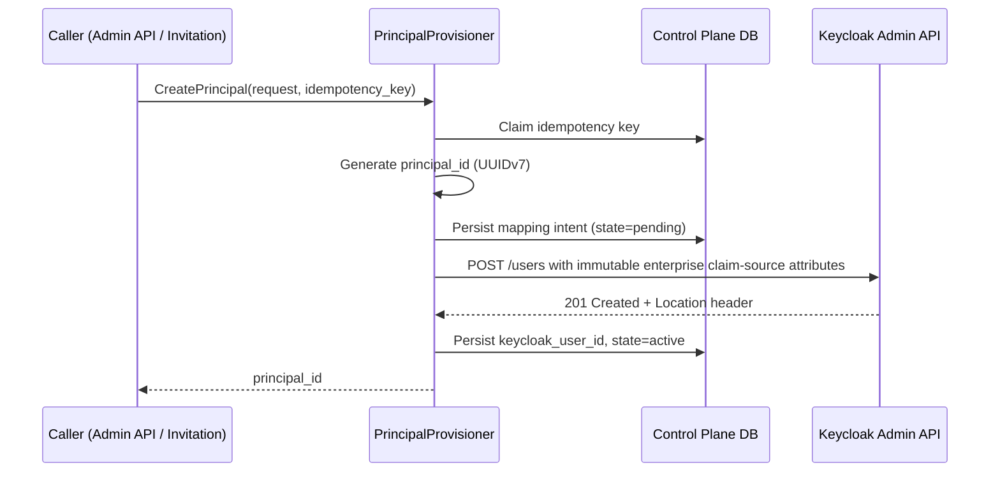

---
doc_meta:
  id: TDD-identity-control-001
  title: Canonical Principal Identifier and Creation Path
  owner: Core Platform Team
  version: 1.29.0
  status: approved
  classification: restricted
  review_cycle_days: 90
  created_date: 2026-08-10
  last_reviewed: 2026-10-25
  parent_sad: SAD-001
---

# Canonical Principal Identifier and Creation Path

## Purpose

Specify how the Scnehaux canonical Principal identifier is generated, stored,
propagated into tokens, and verified, so that no enterprise domain ever persists a
Keycloak-internal identifier as a foreign key.

This design implements the accepted Principal Identifier decision: Scnehaux mints a
canonical `principal_id`; Keycloak retains its own protocol subject. The two are
distinct claims with distinct lifetimes and distinct portability guarantees.

The identifier contract is irreversible in practice. Once tokens carrying a subject
identifier have been issued and downstream domains have persisted it, changing the
identifier is an enterprise-wide referential migration rather than a configuration
change. This design therefore fixes the contract before the first Principal exists.

## Scope

**In scope**

- Generation, format, and uniqueness invariant of `principal_id`.
- Storage of `principal_id` inside the Keycloak user representation.
- The single authorized Principal creation path through the Identity Control Service.
- Idempotency and crash-recovery behavior of that path.
- Detection and quarantine of Principals created outside the authorized path.
- The `principal_id` token claim and the verifier invariant that depends on it.

**Out of scope**

- Protocol subject (`sub`) semantics, pairwise subject derivation, and external
  token profiles — owned by the STD-IAM-002 Token and Verification Profile.
- Realm and issuer topology — owned by the Realm & Issuer decision.
- Credential material, authenticator enrollment, and authentication ceremonies —
  owned by the Keycloak Identity Kernel.
- Membership, Tenant, and Workspace authority - owned by `organization-control`;
  projection into Keycloak is owned by `TDD-identity-control-002`.
- Migration of identifiers from any prior identity implementation.

## Technical Context

Two runtimes participate:

| Runtime | Role in this design |
| :-- | :-- |
| Keycloak Identity Kernel (SAD-001) | Physical storage of the Principal record and its immutable `scnehaux_principal_id` attribute; issues tokens carrying the claim |
| Identity Control Service (SAD-001) | Mints `principal_id`, performs the only authorized creation call, owns the mapping table, runs reconciliation |

The authority split is deliberate. Keycloak is the physical system of record for the
Principal row. Scnehaux is the authority for the identifier that the rest of the
enterprise references. Exiting Keycloak therefore requires migrating credential
material and protocol configuration, and does not require rewriting foreign keys in
Membership, HCM, audit, evidence, or analytical stores.

Three constraints shape the component design:

1. Keycloak does not enforce uniqueness on user attributes. The uniqueness invariant
   for `principal_id` is held by the Control Database, not by Keycloak.
2. Creating a Keycloak user and setting an attribute in two separate calls produces a
   window in which a Principal exists without a canonical identifier. The design
   removes that window rather than compensating for it.
3. Keycloak can create users without the Control Plane in the request path through
   self-registration and federated first-login. Both are disabled in this phase.

## Component Design

### Components

| Component | Module | Responsibility |
| :-- | :-- | :-- |
| `PrincipalProvisioner` | `internal/identity/provisioning` | Mints the identifier, performs the create call, owns idempotency |
| `KeycloakAdminClient` | `internal/identity/keycloak` | Typed wrapper over the supported Admin REST API |
| `PrincipalMappingRepository` | `internal/identity/provisioning` | Persists and enforces uniqueness of the mapping |
| `PrincipalReconciler` | `internal/identity/provisioning` (`sweep.go`) | Periodic sweep for unmapped, orphan, duplicate and dangling Principals (1.13.0) |
| Realm protocol mapper | Keycloak configuration | Projects the user attribute into the `principal_id` token claim |

### Creation Path



The identifier and subject classification are fixed before the remote call and carried
inside the creation payload. The Keycloak representation accepts attributes at creation
time, so the Principal never exists without the complete claim source required by its
audience profile.

**A human is created owing a password, and holding none (1.21.0).** The kernel user carries the
required action `UPDATE_PASSWORD`, and this path sets no credential. A required action runs only
"after the user provides credentials", so the person cannot sign in until a provider gives them a
first credential: `POST /v1/principals/{principal_id}:issue-temporary-password` (`ADR-IAM-010`,
`TDD-identity-control-005` 2.12.0 §A First Credential). That command reads the outstanding
`UPDATE_PASSWORD` as the sign that the person has never set a password of their own. The bootstrap
ceremony below is unchanged: its operator exists before any provider can issue.

### Authorized and Prohibited Creation Paths

```text
Authorized
    Identity Control Service → Keycloak Admin API
        via POST /v1/principals              ordinary path, authenticated caller
        via the bootstrap ceremony           single use per Control Database
        via an enrolment (built, 1.27.0)     the BFF workload, for an invitee who proved the invited address

Prohibited in this phase
    Self-registration
    Federated first-login auto-create
    Direct Admin Console user creation
    Any write to the Keycloak database
    Any direct write to identity.principal_mapping
```

Prohibited paths are closed by realm configuration rather than by policy alone. The
reconciler treats any Principal that appears without a mapping as evidence that a
prohibited path is open, and quarantines it.

#### Enrolment From an Invitation (built 1.27.0)

1.24.0 to 1.27.0, `ADR-IAM-011` §5.1 to §5.9 (accepted 2026-10-20, amended twice on 2026-10-21) and
`STD-IAM-001` 3.1.0 §3.1. **Built in 1.27.0** (`ROADMAP.md` item 17); the resolve client was built in
1.26.0. A person invited to a Tenant who holds no account creates one from the invitation, after
proving the invited address. It is the third authorized creation path, beside the ceremony and
`POST /v1/principals`. It creates the Principal through the ordinary path's code (`provisioning.Create`),
so the pending mapping, its recovery and the sweep are the same.

```text
POST /v1/enrolments                       the BFF workload, for an anonymous person   {"token"}  -> 202
POST /v1/enrolments/{enrolment_id}:verify the BFF workload, for an anonymous person   {"code"}   -> 201
GET  /v1/enrolment-callers                provider
POST /v1/enrolment-callers                provider, Idempotency-Key, reason           {"principal_id","purpose"}
POST /v1/enrolment-callers/{principal_id}:retire   provider, Idempotency-Key, reason
```

**The caller is the BFF workload, admitted from a record (§5.8).** The two enrolment routes are
anonymous as to the person and not as to the caller. Identity Experience's BFF calls them as a
registered workload with an owner (`ADR-IAM-003 §5.8`) and its own client key.

- **The record.** `identity.enrolment_caller` names the workload's `principal_id`, its purpose, who
  registered it and why, and when it was retired, as `ADR-ORG-001 §5.11` admits a reporter from a
  row. A provider registers and retires it, with a reason; a registration names an active workload
  Principal of this service (`identity.principal_mapping` with `subject_type` `workload`).
- **The token.** It is verified as every caller's is (issuer, audience, signature, `at+jwt`), with
  `subject_type` `workload` and no `tenant_id` or provider scope. Its `principal_id` must be an active
  row of the record, read for each request. Any other token is `401` or `403`, and the routes are
  mounted apart from the caller routes, behind this check alone, as the identifier match is
  (TDD-identity-control-008 1.7.0).
- **The client address comes from `Forwarded`, only on this workload's call.** Only the first
  element's `for` is read. It must be an IPv4 address or a bracketed IPv6 address, with an optional
  port. The address is counted as itself for IPv4 and as its /64 prefix for IPv6 (§5.8). A missing,
  obfuscated (`_…`), `unknown` or malformed value is `400`, before any count or lookup: one shared
  bucket would stop everyone, and the status depends on nothing about the token. On no other route is
  `Forwarded` read. RFC 7239 §5.2: "The "for" parameter is used to disclose information about the
  client that initiated the request", and §8.1: the header "cannot be relied upon to be correct", so it
  is trusted from this one authenticated caller and from no chain behind it.

**The counts (§5.8).** `identity.enrolment_count` holds one row per counted key and rule: a keyed hash,
the rule, the window's end and the count. The hash is HMAC-SHA256 under a key derived from the
`security_ref` sealing key for this purpose alone, over `address:<address or /64>` or
`invitation:<invitation_id>`, so the table holds no address and no invitation identifier. A window
starts at its first count and lasts its length; a sweep deletes every row whose window has ended, each
minute. A rotation of the `security_ref` ring changes the key, so counts restart, at most once per
rotation.

| Rule | Limit | At the limit |
| :-- | :-- | :-- |
| `request` per client address | 5 a minute, 20 an hour | `429` with `Retry-After`, before Organization Control is asked |
| `verify` per client address | 5 a minute, 30 an hour | `429` with `Retry-After` |
| messages per invitation | 3 an hour, 5 a day | `202` as always, and nothing is sent |
| failed codes per invitation | 15 a day | the same refusal as a wrong code, before the code is compared |

Every request counts against its address, refused or not, so a `429` says nothing about any invitation.
The per-invitation limits answer as always and do nothing (§5.8: a different answer "would tell the
caller that the token names an invitation"). A message here is a code, or the "an account exists"
message of §5.9 that takes a code's place: both are mail to the invited address, which OWASP's
per-account limit protects from flooding (§5.8 [R17]). `Retry-After` is the whole seconds until the
longest exceeded window ends (RFC 9110 §10.2.3).

**`POST /v1/enrolments` (§5.1, §5.2, §5.9).** In this order:

1. the caller and `Forwarded`, then the body `{"token": "..."}` (a body that is not that is `400`);
2. the `request` counts of the address (`429` past them);
3. the resolve (`internal/organization`, 1.26.0). Nothing found is the `202` below. Organization
   Control unreachable, or not configured (`IDENTITY_ORGANIZATION_BASE_URL` unset), is `503`, the same for
   every token;
4. under a transaction-scoped advisory lock on the invitation, so two requests for one invitation queue:
   - an enrolment of the invitation that is open (its code good and not used up) is the `202`, and
     nothing is sent: one open enrolment per invitation;
   - the message counts at their limit is the `202`, and nothing is sent;
5. the double check (§5.9), against this service and the kernel: an `active` notification address of
   any Principal equal to the address without case, proven or not; a mapping that is not retired whose
   username or email equals it; and a kernel user whose username or email equals it exactly. The kernel
   is read before the transaction; unreachable is `503`;
6. a collision queues the "an account exists" message to the address and counts it. Otherwise the
   enrolment is recorded with its code, and the code's message is queued and counted.

The answer is always `202` `{"enrolment_id": "<uuid>"}`, `Cache-Control: no-store`. When a code was
sent, the identifier is the enrolment's. In every other case it is a fresh UUIDv7 that is stored
nowhere, so the body is the same shape and draws from the same space whatever happened, and a
`:verify` on it is a wrong code. The same identifier never answers twice, so a repeat for an open
enrolment does not reveal it. No token, no invitation identifier and no address is logged; the log
line names the enrolment identifier and the outcome class, which no caller sees.

**The code (§5.2).** 8 digits from `crypto/rand`, as `TDD-identity-control-008` draws an address proof.
The enrolment keeps SHA-256 of the enrolment identifier and the code, so a code proves the enrolment it
was sent for. The message carries the code sealed with `security_ref` (kind `enrolment-code`, bound to
the enrolment identifier), opened by the dispatcher only to hand it to the adapter, then cleared. It is
good for 10 minutes and five attempts, and it is invalidated when the enrolment completes.

**`POST /v1/enrolments/{enrolment_id}:verify` (§5.2, §5.3, §5.9).** `{"code": "<8 digits>"}`.

1. the caller and `Forwarded`, the body, and the `verify` counts of the address (`429`);
2. the enrolment row, locked: unknown, completed, refused, expired, used up, or its invitation past 15
   failed codes today, is the refusal;
3. a wrong code adds an attempt and a failed code to the invitation's count, and is the refusal. The
   right code takes a one-minute lease on the enrolment (`verifying_until`) in the same transaction, so
   a second `:verify` of it meanwhile is `503`, never a second password. Steps 4 to 6 run with no
   transaction open, as the creation path requires, and step 7 ends the lease;
4. the right code: the double check again, immediately before the create, leaving out only the mapping
   this enrolment's own create made (found by its idempotency key, below). A collision consumes the
   enrolment (`refused`), creates nothing, and is the refusal;
5. `provisioning.Create`: caller scope `enrolment`, key the enrolment identifier, username the address
   lower-cased, email the address, human. The creation address is written with `verified_at` set,
   because the code just proved it. A kernel refusal of the user as a duplicate (`409`, a definite answer:
   nothing was created) quarantines the pending mapping in the same step, with the reason, so recovery
   has nothing to finish; the enrolment is consumed and the answer is the refusal (§5.9). An ambiguous
   or unavailable kernel leaves the mapping pending for recovery, the enrolment open and the code good,
   and answers `503`: the person retries the same code, and the create's key replays the Principal;
6. the temporary password, through `firstcredential` as `ADR-IAM-010 §5.1` and §5.2 issue it: 120
   bits, set in the kernel as temporary, lapsing within `IDENTITY_TEMPORARY_PASSWORD_TTL` (24 hours at
   most), recorded without its value. The issuance names the BFF workload as `issued_by` and
   `enrolment <enrolment_id>` as its reason; no provider is involved and no privileged-access row is
   written. A kernel failure answers `503` and leaves the enrolment open, so the same code resumes;
7. the enrolment is `completed`: the Principal and the issuance are recorded, the code's hash and the
   address are cleared.

The answer is `201` `{"principal_id", "username", "temporary_password", "lapses_at"}` with
`Cache-Control: no-store`. The value is never logged, stored or put in an idempotency record
(`STD-IAM-001` 3.1.0 §3.1, the second recipient). Every refusal is one answer: `400`
`validation-failed`, detail "The code is wrong, has expired, or has been tried too often; start again
from the invitation link", the same as an address proof's wrong code. An unknown identifier, a decoy,
a collision and the invitation's daily limit answer it too. A malformed body is `400` with another
detail, which depends on the body alone.

**Neither route takes an `Idempotency-Key`** (`commands.go` names them key-optional with the reason).
A repeat of `POST /v1/enrolments` sends nothing while a code is open, and the counts bound it; a repeat
of `:verify` after completion finds the code invalidated and creates nothing; a repeat after a `503`
resumes through the create's own key. A key here would record the temporary password, which no record
may hold.

**The record (§5.3).** `identity.enrolment`: the identifier, the invitation identifier, SHA-256 of the
address lower-cased, the address while open, the code's hash, its expiry and attempts, the state
(`open`, `completed`, `refused`), the Principal created, the issuance, the BFF workload that carried it,
and when it was created and closed. `identity.enrolment_message` is its delivery queue, as
`identity.security_notification` is for a Principal (the enrolment also holds its `:verify` lease,
`verifying_until`): the kind (`code` or `account_exists`), the address
and the sealed code until handed over, then cleared, the attempts and the outcome. Both are evidence:
the runtime role holds no `DELETE`, and both carry the audit retention triggers (§Audit Retention). The
new Principal holds no Membership; the person accepts the invitation afterwards, signed in, as
`ADR-ORG-007 §5.1` decides (§5.4). The first password the person binds is notified through the kernel
event record, as every first binding is (`ADR-IAM-007 §5.1`).

**Delivery (§5.5).** The security notification dispatcher takes enrolment messages after
notification requests, with the same backoff and attempts. The development mail catcher renders the
code message ("Your code is …") and the account message ("An account exists for this address: sign
in, confirm the address in your account's settings, or ask the person who invited you"), which does not
say whether the address was proven. In production the Notification Platform delivers them; it is a
production gate, as for every proof.

**Telemetry.** `identity.enrolment.requests` counts requests by outcome class (`sent`, `held`,
`limited`, `nothing`, `collision`), `identity.enrolment.verifications` by `completed`, `refused`,
`collision`, `limited`, and `identity.enrolment.limited` the `429`s by rule. Many refusals for one
invitation are seen as the `failed codes` rule reaching its limit, which is logged at `WARN` with the
enrolment identifier, never the invitation's.

**Tested** (`internal/enrolment`, against PostgreSQL and the kernel fake, with the real creation and
first-credential paths): the whole path once, and the password in no row; every non-sending outcome a
fresh identifier no enrolment holds, with the account message for a held address, proven or not, a
kernel username and a kernel email; the per-invitation message limit silent; the address limits `429`
before Organization Control is asked; five attempts per code and 15 failures per invitation; a holder
appearing before the create, and a kernel duplicate at the create, creating nothing and leaving no
pending mapping; a lost create resumed by the same code after recovery; the sweep; the caller record;
and no token, address, code or password in any log line. `internal/httpapi`: the caller check,
`Forwarded` (`ClientAddress`), each outcome's one answer, `Retry-After` and `no-store`.
`internal/securitynotify`: the messages handed over and cleared. `deploy-dev`:
`scripts/dev-enrolment-proof.ps1`, the caller check, `Forwarded` and the limits on the running stack.

**The resolve client (1.26.0).**

- **The resolve client (1.25.0, `ADR-IAM-011` §5.7 as amended 2026-10-21; built in 1.26.0).** This service reaches
  the route as a registered workload, admitted from a registry row, not from a scope or a `client_id`.
  Organization Control's reporter registry gains an `invitation:resolve` entry for this workload's
  `principal_id`, and that entry reaches the resolve route alone. It is not this service's consumer
  registration (`SAD-004` §7.6), which admits it to the consumer routes only. The workload has an owner
  and a review (`ADR-IAM-003 §5.8`) and signs in with its own client key, in development as in
  production: no development flag admits another caller. Every outcome of the route that is not an
  invitation is one `404` with one body (§5.7 (b)); the client treats it as "nothing" and never
  forwards it, so its own answer stays the `202` above. Each call is recorded by Organization Control
  with the entry's purpose, `invitation:resolve` (NIST AU-3). The client's own limits per invitation and
  per client address bound the calls (§5.2).
- **The resolve call, as built (1.26.0, §5.7 (a) and (b)).** `internal/organization`
  `ResolveInvitation` sends `POST {IDENTITY_ORGANIZATION_BASE_URL}/v1/invitations/resolve` with this
  service's workload token (the clientauth source the consumer routes use, `identity-control-workload`,
  audience `organization-control-api`) and `{"token":"..."}` as the JSON body. The token is never in
  the path or the query. It sends no `Idempotency-Key`: the call changes nothing. Neither the token nor
  the address is logged or put in an error. It has four outcomes:
  - `200` with `invitation_id` (a UUID, not nil) and `target_identifier` (not empty): the invitation.
    Any other `200` body is an error.
  - `404` with the problem type `invitation-not-acceptable`, and `400` with `validation-failed` (a
    malformed token): "nothing", with no error. To the enrolment command a malformed token is an
    unknown one, and its answer is the `202` of §5.1 either way. A `404` or `400` with any other type
    is an error: a missing route is not an unknown invitation.
  - `403`: this workload holds no active `invitation:resolve` entry there. An error, `ErrRefused`, a
    misconfiguration.
  - `401`, `5xx` or a transport failure: an error, since unknown is not no. A `401` drops the cached
    token, so the next call presents a fresh one, as on the consumer routes; it does not retry.
  The `invitation:resolve` entry is registered in organization-control, not here: its
  `scripts/dev-wire.ps1` registers it in development (`ADR-ORG-001` §5.11).

#### The Bootstrap Ceremony

`POST /v1/principals` requires a caller holding a `principal_id`, and it is the only path that
issues one. A fresh realm therefore has no entry point, and the ceremony is it. `ADR-IAM-001 §5.11`
records the decision and why a standing break-glass identity was rejected.

It is a command on the deployable rather than an endpoint, because an endpoint that creates a
Principal without an authenticated caller is a permanent hole in the API whether or not a guard
currently closes it.

**Structural guarantees, in the order the code relies on them.**

```sql
CREATE TABLE identity.bootstrap_ceremony (
    id              INTEGER     PRIMARY KEY,
    operator        TEXT        NOT NULL,
    witness         TEXT        NOT NULL,                     -- 1.23.0
    reason          TEXT        NOT NULL,
    idempotency_key TEXT        NOT NULL,
    principal_id    UUID,
    requested_at    TIMESTAMPTZ NOT NULL DEFAULT now(),
    CONSTRAINT bootstrap_ceremony_single_row CHECK (id = 1),
    CONSTRAINT bootstrap_ceremony_witness_check
        CHECK (btrim(witness) <> '' AND lower(btrim(witness)) <> lower(btrim(operator)))
);
```

1. `id = 1` under a primary key makes the table hold at most one row. A second ceremony is
   refused by a constraint, not by a `SELECT count(*)` the next refactor could drop, and two
   concurrent ceremonies produce one Principal rather than two.
2. The claiming transaction asserts `identity.principal_mapping` is empty. Together with (1)
   this means the ceremony can only ever run on a virgin registry.
3. The row is **insert-only**. `grants.sql` revokes `UPDATE` and `DELETE` from the runtime role
   on this table specifically, so the operator, the witness and the reason on record cannot be
   rewritten — by the application, by a retry, or by whoever runs the ceremony a second time.
4. `idempotency_key` is claimed in the same row rather than generated per invocation. A ceremony
   that crashes after the kernel call resumes against the same key, so the recovery path that
   already exists for the API applies unchanged and a retry cannot mint a second Principal.

**Two people run it, and a third reviews it (1.23.0).** `STD-IAM-001` 2.9.0 §3.10 and `ADR-IAM-001`
§5.11 requirement 3, as amended 2026-10-20, take the ceremony from one operator to two named people,
an operator and a witness, and an independent review of the record:

- **The witness.** `identity-bootstrap -witness <name>` is required beside `-operator`, and the
  ceremony refuses a witness equal to the operator, compared trimmed and case folded, before anything
  is written. The database refuses it too (`bootstrap_ceremony_witness_check`). A resume reuses the
  recorded witness, as it reuses the operator and the reason. NIST: "Dual authorization, also known as
  two-person control, reduces risk related to insider threats" (SP 800-53 AC-3(2), `ADR-IAM-001`
  [R63]). The migration that added the column writes "not recorded: the ceremony ran before a witness
  was recorded" on a row claimed before it, rather than naming someone.
- **The record, read through the API.** `GET /v1/bootstrap-ceremony`, a provider's route, answers
  the operator, the witness, the reason, the `principal_id`, `requested_at`, `reviewed` and every
  review, oldest first. The idempotency key is not served. Before 1.23.0 only a database role could
  read the record.
- **The review.** `POST /v1/bootstrap-ceremony:review`, a provider's route with an `Idempotency-Key`
  (replayed) and the finding as `X-Administrative-Reason`, takes `{"reviewer": "<name>", "outcome":
  "satisfactory" | "findings"}` and answers `201` with the review. It is recorded insert-only in
  `identity.bootstrap_ceremony_review`: reviewer, the Principal whose token recorded it, outcome,
  statement, correlation and time. It answers `409` when the reviewer is the operator or the witness,
  or the caller is the first Principal, and `404` when no ceremony is on record.
- **The database refuses a review that is not independent.** The review row carries the ceremony's
  operator, witness and Principal, held to the ceremony's own by a composite foreign key onto the
  unique key `bootstrap_ceremony_review_key (id, operator, witness, principal_id)`, and a check
  compares the reviewer with each. A review written past the code, naming the witness, or naming
  another ceremony's people, is refused by PostgreSQL. AC-5 asks "that security personnel who
  administer access control functions do not also administer audit functions" (`STD-IAM-001` [R41]).
- **Who is served before the review (1.24.0).** `STD-IAM-001` 2.10.0 §3.10 and `ADR-IAM-001` §5.11
  requirement 3, amended 2026-10-20: "Until the bootstrap review is recorded, the realm serves the
  first Principal and the reviewer, and no one else". The reviewer reads the record through a
  provider's sign-in, so the first Principal creates the reviewer's Principal and Organization grants
  it, and nothing else is created until the review is recorded. The runbook's step order holds it; the
  code enforces no gate on it, as it enforces no deadline.
- **Who and when are the owner's.** The names of the ceremony role and the reviewer, and the review
  deadline, are the owner's in `STD-IAM-001` §3.10; `docs/runbooks/bootstrap-ceremony.md` §Who
  performs it holds the placeholders. The route records any review; it does not enforce a deadline.

**The ceremony holds no credential.** The kernel user is created with a required
credential-setting action, so the first human interaction establishes the credential. A ceremony
that set a password would be a process holding a credential for an identity it also authorized,
which is the concentration `ADR-IAM-001 §5.10` exists to prevent.

**The ceremony registers this service's resource** (`ADR-IAM-001 §5.11` rule 5). A caller's token
is admitted only when its `aud` names a registered protected resource (STD-IAM-002 §3.1), and the
first call after the ceremony is to this API, so the resource must exist before any token can name
it. Registering it through the API would need such a token first. The ceremony registers it through
the registration path's own Admin API client, as `POST /v1/registrations` would:

| Field | Value |
| :-- | :-- |
| `client_key` | `IDENTITY_TOKEN_AUDIENCE`, `identity-control-api`: one setting, so the resource the ceremony registers and the audience the service verifies cannot disagree |
| `profile`, `audience_class`, `lifetime_class` | `resource`, `privileged`, `L0` |
| `registered_by` | the Principal the ceremony created |
| idempotency | scope `ceremony:bootstrap`, key `bootstrap-resource:<realm>` |

A ceremony interrupted after the Principal exists names the failed registration and is resumed
with `-resume`, which replays the Principal and completes the registration once. An estate whose
ceremony ran before this rule registers the resource the same way, by resuming with the recorded
operator, username and email, and then moves its callers' audience to it by an audience change
(`TDD-identity-control-003` §Registration Changes).

**The ceremony's Principal is the first provider.** It records that Principal in its own row as a
local emergency grant, honored until Organization's first emergency `provider:identity-control`
grant is projected, and retired then by an insert-only record (`ADR-ORG-002 §5.4`,
`TDD-identity-control-006` §The Ceremony's Grant). It no longer writes the kernel attribute
`scnehaux_provider_scope`.

**Why not simply relax the API for the first call.** A route that accepts an unauthenticated
request when a table is empty is a route whose authorization depends on data. The table is empty
in every fresh environment, including a restored-from-backup one and a mistakenly-pointed-at one,
and the failure is silent: the request succeeds.

#### The Signing Key Registry (built 1.29.0)

ADR-IAM-002 §5.5, amended 2026-10-24, puts the realm signing keys' registry here (Q5), with the
approvals and the event (Q9). The kernel's rotation steps own the keys and their providers
(`TDD-identity-kernel-002` §Rotation as Built). This service keeps the record of each key and refuses
a step the record does not allow. The registry is evidence. It has no authority over key material,
and it never holds any.

**Three insert-only tables** (migration `20261025100000_signing_key_registry`):

| Table | One row per | Written by | Holds |
| :-- | :-- | :-- | :-- |
| `signing_key` | key | `stage`, once | `kid`, realm, `algorithm` (`PS256`), `public_jwk`, `custody_ref`, the ceremony's operator and witness, reason, correlation identifier, `staged_at` |
| `signing_key_approval` | approval of one transition of one key | `approve` | the transition (`activate`, `retire`, `abandon` or `revoke`), the step's operator, the approver, `emergency`, reason, correlation identifier, `approved_at` |
| `signing_key_transition` | transition | `stage` and `record` | the step (`stage`, `activate`, `demote`, `retire`, `abandon`, `revoke`), the states it leaves and enters, the actor, the approval, reason, correlation identifier, the outcome, the evidence, `occurred_at` |

- **A key's state is its latest completed transition.** The states are ADR-IAM-002 §5.2's: `staged`,
  `active`, `retiring`, `retired`, `revoked`. A partial unique index lets each key enter each state
  once, so a `retiring` key can never be `active` again (Q6). Another lets each approval complete one
  transition of its key, so an approval cannot be reused (Q9).
- **`public_jwk`, the algorithm and `custody_ref` are written once**, at staging (Q5). `stage`
  computes the RFC 7638 thumbprint of the JWK and refuses a `kid` that differs, a key that is not RSA,
  and a modulus under 3072 bits (ADR-IAM-002 §5.1, §5.2).
- **Insert-only.** The runtime holds no `UPDATE`, `DELETE` or `TRUNCATE` on the three tables
  (`grants.sql`). They carry the retention triggers (§Audit Retention).
- **No foreign keys between them.** Each audit table keeps and purges its own rows, as the enrolment's
  do. The command reads the key row before it writes a dependent one, in the same transaction.

**The command is `identity-signing-key`,** on the migrate image, as `identity-bootstrap` is. No
endpoint exists for it (Q9: "so no new endpoint exists to protect"). It uses the runtime credential and
reaches only the Control Database.

| Subcommand | Writes | Refuses |
| :-- | :-- | :-- |
| `stage -realm -kid -jwk -custody-ref -operator -witness -reason -correlation` | the key row and its `stage` transition (no state → `staged`) | a `kid` already registered; a witness equal to the operator; a `kid` that is not the JWK's thumbprint |
| `approve -realm -kid -transition -operator -approver -reason -correlation [-emergency]` | an approval row | an approver equal to the operator; for `activate`, an approver who generated the key; a transition the key's state does not allow; `-emergency` on anything but `activate` |
| `check -realm -kid -transition -operator [-min-age]` | nothing; prints the approval's identifier | no unused approval for that key, transition and operator; a state that does not allow it; a state entered less than `-min-age` ago, unless the approval is an emergency activation |
| `record -realm -approval -outcome completed\|failed [-evidence]` | the transition, and for an activation the previous active key's `demote` | a completed retirement, abandonment or revocation without evidence; a transition the state no longer allows |
| `state -realm [-kid]` | nothing; prints each key's state as JSON lines | — |

The transitions it allows, all from ADR-IAM-002 §5.2 and §5.5:

| Step | From | To | Approval | Note |
| :-- | :-- | :-- | :-- | :-- |
| `stage` | — | `staged` | none: the ceremony's operator and witness | Q5 |
| `activate` | `staged` | `active` | `activate`, by neither the generating operator nor the step's operator | Q9. The kernel passes the cache window as `-min-age`; an emergency approval skips it (Q7) |
| `demote` | `active` | `retiring` | the activation's | written with the activation, in its transaction, for the realm's previous active key |
| `retire` | `retiring` | `retired` | `retire` | the kernel passes the retirement window as `-min-age`; evidence is the destruction's (Q8) |
| `abandon` | `staged` | `retired` | `abandon` | the row's reason is `abandoned` (Q6) |
| `revoke` | `staged` or `retiring` | `revoked` | `revoke` | Q7: a compromised active key is demoted by its replacement's activation first, so no moment has no active key |

- **Who approves.** The ceremony role is the owner's to name (STD-IAM-001 §3.10), and its holders are
  named in `docs/runbooks/bootstrap-ceremony.md`. The command records names, as the ceremony does,
  and refuses the combinations Q9 forbids, compared trimmed and case-folded (a database check for
  approver and operator, the command for the generating operator).
- **The outcome.** The kernel's step records `completed` after it acts, and `failed` with the error
  as evidence when it stops part way. A failed row changes no state and leaves the approval unused.
- **The event (Q9).** The transition row carries actor, approver (through its approval), reason,
  correlation identifier and outcome. It is the privileged-administration event, kept here until
  Audit & Evidence has it (STD-IAM-001 §3.8). The kernel's admin events and CloudTrail corroborate it
  by the correlation identifier.
- **The first key.** It is activated by `realm-apply` on an empty realm (ADR-IAM-002 §5.5 Q4), before
  this service runs, because this service needs the realm. Once the Control Database exists, the
  operator stages it from its ceremony record and records its activation under an approval, in that
  order, so the registry holds every key the realm has signed with.
- **Concurrency.** Each write locks the key's row (`FOR UPDATE`), and an activation also takes a
  transaction-level advisory lock on the realm, so two activations cannot each demote the same key or
  leave two keys active.

**Backup and retention (STD-GLB-007 1.3.0).** The rows are in the Control Database, so `backup.sh`
and the restore drill carry them with every other table (§Restore Evidence); the keys directory is
never backed up, and the registry does not depend on it (ADR-IAM-002 §5.3, §5.5 Q5). They are audit
records and state together: a key's rows decide what the next step may do while the key exists. They
are kept while the key is in force and for 7 years after it ends, counted from its `retired` or
`revoked` row, as the CA/Browser Forum counts CA key records "after the later occurrence of" the key's
destruction (STD-GLB-007 [R5]). The scheduled pass purges a key's three kinds of row together, once
that row is 7 years old (§Audit Retention).

**Restore to an earlier point.** A restored Control Database can lack transitions the kernel has
made. The kernel's steps read the realm's providers before they ask the registry, so a step on a key
whose registry state is behind refuses, and the operator records the missing transitions from the
kernel's admin events and CloudTrail under new approvals (`docs/runbooks/control-database-restore.md`).

**Tested against PostgreSQL** (`internal/signingkey`): the full lifecycle of two keys through
staging, activation with the previous key's demotion, retirement after the window, and an abandoned
and a revoked key; each refusal in the tables above; an approval used twice; a reactivation; two
concurrent activations; and the retention triggers and purge (`internal/controldb`).

## Data Model

### Control Database

```sql
CREATE TABLE identity.principal_mapping (
    principal_id       UUID        PRIMARY KEY,
    keycloak_user_id   TEXT        UNIQUE,
    realm              TEXT        NOT NULL,
    subject_type       TEXT        NOT NULL,
    workload_owner     UUID,
    state              TEXT        NOT NULL,
    created_at         TIMESTAMPTZ NOT NULL DEFAULT now(),
    activated_at       TIMESTAMPTZ,
    quarantined_at     TIMESTAMPTZ,
    quarantine_reason  TEXT,
    version            INTEGER     NOT NULL DEFAULT 1,
    idempotency_scope  TEXT,       -- (1.14.0) the creating request's claim, so recovery completes it
    idempotency_key    TEXT,
    request_digest     TEXT,
    CONSTRAINT principal_mapping_state_check
        CHECK (state IN ('pending', 'active', 'suspended', 'quarantined', 'retired')),
    CONSTRAINT principal_mapping_subject_check
        CHECK (subject_type IN ('human', 'workload')),
    CONSTRAINT principal_mapping_owner_check
        CHECK ((subject_type = 'human' AND workload_owner IS NULL)
            OR (subject_type = 'workload' AND workload_owner IS NOT NULL)),
    CONSTRAINT principal_mapping_active_linked_check
        CHECK (state <> 'active' OR keycloak_user_id IS NOT NULL)
);
```

**Departure recorded: the row carries the creation payload.** Two columns were added during
implementation, `username TEXT NOT NULL` and `email TEXT`, because the recovery algorithm
below cannot be written without them.

Recovery retries the create when the kernel holds no matching user. Retrying requires the
payload of the original call, and the columns above name an identifier, a realm, a subject
type, and an owner — none of which is a username. A pending row was therefore
unrecoverable: the branch could not run, and the caller's idempotency key would stay
in-progress permanently with no path out, because a repeated request against an unfinished
claim returns `ErrInProgress` rather than retrying.

Passing the payload into the recovery sweep instead was considered and rejected. A sweep
resolves many mappings, each from a different request, so one payload supplied by the caller
would have been applied to every mapping the sweep touched.

The payload is Tier-2 identifiable PII under STD-GLB-007 and is encrypted at rest with the
rest of the Control Database. It is the argument of a call this service makes and not a
second authority for identity attributes: Keycloak owns the live values, and a change made
there is not reflected here. `username` is refused as empty before the insert rather than at
the database, so the failure names the reason instead of a column.

**1.18.0 removes the partial unique index on `(realm, keycloak_user_id)`.** Up to 1.17.0 the design
specified it beside `keycloak_user_id TEXT UNIQUE`, and both were built. The column's own constraint
already makes every non-null value unique across all realms, and PostgreSQL treats nulls as distinct,
so it permits many pending rows; a pair is unique whenever one of its members is, so the index could
refuse nothing the constraint admits. No statement names it: every lookup by `keycloak_user_id` is an
equality the constraint's own index serves, and no `ON CONFLICT` infers it. The redundancy was
recorded and left for a review rather than resolved in an implementation commit; this version is
that review. Migration `20261009110000_drop_redundant_principal_index` drops it. It is not a
destructive change in the sense of `STD-GLB-002`, which names data loss: an index holds none, and
the constraint keeps the invariant unchanged. The repository's text gate matches `DROP INDEX`, so
the statement carries its reviewed annotation.

`principal_id` is the primary key and the enterprise-wide reference. `keycloak_user_id`
is nullable while the mapping is `pending`, and is never exposed outside this module.
`principal_mapping_active_linked_check` makes that the only state where it can be
absent: an active mapping with no Keycloak user would be served by nothing, and
recovered by nothing, because recovery reads only `pending` rows.

State transitions:

```text
      relink
   ┌──────────┐
   ↓          │
pending ──→ active ──→ retired
   │         ↑  │        ↑
   │ restore │  │ suspend│
   │         │  ↓        │
   │        suspended ───┘
   │          │  ↑ release (1.18.0)
   └──────────┴──┴─→ quarantined
```

**`suspended` is containment, and it is reversible.** An administrator suspends a Principal to
stop it signing in while an incident is investigated, and restores it afterwards
(`TDD-identity-control-005` §Containment Is Reversible). The kernel user is disabled and its
sessions ended, and nothing else changes: its Memberships, ownerships and grants are kept, as
Okta keeps a suspended user's assignments and reinstates them on unsuspend. **`quarantined` is
different.** It is the reconciler's hold on a mapping whose invariants are broken: a Principal made
outside the authorized path, or a duplicate. No administrator sets it. It is left by `:release`
(1.18.0, §Leaving Quarantine), which lands in `suspended`, or by a retirement. A suspended Principal
may be retired.

**`relink` is the one way back from `active`.** A Principal outlives its Keycloak user.
The user can be deleted in the console, or lost with a realm rebuilt from nothing, and
the `principal_id` that every domain keys on, with every Membership held under it, must
survive that. `relink` clears `keycloak_user_id` and returns the mapping to `pending`.
The recovery below then does what it does for any pending mapping: it adopts a user
carrying the identifier, or creates one with the same `principal_id`. Nothing outside
this table changes, since `organization-control` holds Memberships by `principal_id`.

**A workload's retirement retires its Principal.** A workload's Keycloak user is its client's
service account, and deleting the client deletes it. The workload lifecycle therefore moves the
mapping to `retired` in the transaction that deletes the client (`TDD-identity-control-004`
§Suspension, Restoration, and Retirement). A human Principal's `:retire` is a separate route and is
not built.

```sql
CREATE TABLE identity.principal_relink (
    relink_id                 UUID        PRIMARY KEY,
    principal_id              UUID        NOT NULL REFERENCES identity.principal_mapping(principal_id),
    previous_keycloak_user_id TEXT        NOT NULL,
    relinked_by               UUID        NOT NULL,
    reason                    TEXT        NOT NULL CHECK (btrim(reason) <> ''),
    relinked_at               TIMESTAMPTZ NOT NULL DEFAULT now()
);

CREATE TABLE identity.principal_finding (
    finding_id           UUID        PRIMARY KEY,
    principal_id         UUID        REFERENCES identity.principal_mapping(principal_id),
    finding_class        TEXT        NOT NULL
        CHECK (finding_class IN ('dangling', 'unmapped', 'orphan', 'duplicate')),
    keycloak_user_id     TEXT        NOT NULL,
    realm                TEXT        NOT NULL,
    claimed_principal_id TEXT,                    -- orphan: the identifier the user carries
    username             TEXT,                    -- the kernel user's username, for triage
    user_disabled        BOOLEAN     NOT NULL DEFAULT false,
    detected_at          TIMESTAMPTZ NOT NULL DEFAULT now(),
    resolved_at          TIMESTAMPTZ,
    resolution           TEXT,
    CHECK ((resolved_at IS NULL) = (resolution IS NULL)
        AND (resolution IS NULL OR resolution IN ('relinked', 'user_present', 'user_absent'))),
    CONSTRAINT principal_finding_subject_check CHECK (
        (finding_class IN ('dangling', 'duplicate') AND principal_id IS NOT NULL AND claimed_principal_id IS NULL)
     OR (finding_class = 'unmapped' AND principal_id IS NULL AND claimed_principal_id IS NULL)
     OR (finding_class = 'orphan' AND principal_id IS NULL AND claimed_principal_id IS NOT NULL))
);

CREATE UNIQUE INDEX principal_finding_open_user
    ON identity.principal_finding (realm, finding_class, keycloak_user_id) WHERE resolved_at IS NULL;
```

**1.13.0 widens the finding to the sweep's other three branches.** An `unmapped` or `orphan`
finding names a kernel user no mapping accounts for, so it has no `principal_id`; an orphan
records the identifier the user carries, which no mapping holds and which may not even parse.
`username` is recorded so whoever triages the finding can find the user: `keycloak_user_id` never
leaves this module. `user_disabled` says whether the sweep disabled the user, which it does only
under `IDENTITY_UNMAPPED_USERS=disable` (§Reconciliation Sweep). One open finding per class and
kernel user replaces one per Principal, because a duplicate is one finding per extra user. `realm`
is recorded because a finding without a Principal has no mapping to read it from; the migration
fills it for the dangling findings recorded before.

`principal_relink` is insert-only for the runtime role: a Principal's move to a new
Keycloak user is exactly the change whose record must not be rewritable by the process
that made it. A finding is kept after it resolves, and the runtime deletes none.

```sql
-- 1.18.0: a quarantined mapping released to suspended, insert-only for the runtime role
CREATE TABLE identity.principal_release (
    release_id                UUID        PRIMARY KEY,
    principal_id              UUID        NOT NULL REFERENCES identity.principal_mapping(principal_id),
    previous_keycloak_user_id TEXT,       -- null for a mapping recovery quarantined, which held none
    keycloak_user_id          TEXT        NOT NULL,
    quarantine_reason         TEXT,       -- the reason the mapping was held, as it stood
    released_by               UUID        NOT NULL,
    reason                    TEXT        NOT NULL CHECK (btrim(reason) <> ''),
    released_at               TIMESTAMPTZ NOT NULL DEFAULT now()
);
```

#### Migration Gates (1.24.0)

`ADR-GLB-004` §5.1 asks the pipeline to "block a destructive schema change from reaching production
without a reviewed multi-phase plan", and says "A pipeline that implements items 1 and 2 meets this
gate. It is not a waiver". `ci.yml` runs items 1 to 3 on every change, in this order:

1. **Integrity.** `atlas migrate validate --env ci`: `atlas.sum` fails when a committed migration was
   edited after it was hashed.
2. **The destructive-statement gate, split at one cutover**, the last migration applied before squawk,
   `20261019142657_first_credential`:
   - Up to and including the cutover, a text match for `DROP TABLE`, `DROP SCHEMA`, `DROP COLUMN`,
     `DROP CONSTRAINT`, `DROP INDEX`, `RENAME TO`, `RENAME COLUMN` and `TRUNCATE`, each approved by an
     `atlas:destructive-approved` comment on its line. Those migrations were reviewed against it, and
     their lines cannot change: editing an applied migration fails step 1.
   - After the cutover, squawk v2.70.0, "Linter for Postgres migrations & SQL", the gate's preferred
     form (§5.1 item 2, amended 2026-10-20). It parses each statement, so a word in a comment is not
     flagged, and an approval is a `-- squawk-ignore <rule>` comment on the line before, naming the one
     rule it waives. It is downloaded by version and checked against the release asset's sha256, as
     `STD-GLB-009` §Container Images rule 6 asks of a scanner.
   - squawk 2.70.0 bans `TRUNCATE` only with `CASCADE`, so the text match keeps `TRUNCATE` over the
     migrations after the cutover too, approved the same way. A trigger that refuses it names it:
     `20261020200000_audit_retention` carries the approval on each `BEFORE TRUNCATE` line.
3. **Synchronisation.** `atlas migrate diff --env ci drift_check`, then a clean working tree:
   `schema.hcl` and `migrations/` agree.

`atlas migrate lint` (item 4) needs an Atlas Pro login and is not run; `atlas.hcl` keeps its
configuration for the day one exists.

**`.squawk.toml`**:

- `pg_version = "17.0"`, the server every environment runs.
- `assume_in_transaction = true`: "By default, Atlas creates one transaction per migration file"
  [R19], so the rules that ask for guards a partly applied file would need do not apply.
- **The timeouts.** squawk's `require-timeout-settings`: "You must configure a `lock_timeout` to safely
  apply migrations", and "a statement_timeout also helps prevent long migrations that consume too many
  database resources" [R20]. Each migration after the cutover opens with `SET LOCAL lock_timeout =
  '5s';` and `SET LOCAL statement_timeout = '60s';`. `SET LOCAL` ends with the file's transaction, so
  the values never reach the next file. The two values are the estate's: `ADR-GLB-004` §5.1 item 2,
  "Every new migration sets its own lock and statement timeouts (amended 2026-10-20)".
- **One excluded rule**, `prefer-bigint-over-int`, whose problem is "Using 32 bit integer fields can
  result in hitting the max int limit" [R21]. The schema uses `integer` only where a value is bounded:
  the single-row records, attempt counters, a run's counts and a mapping's version. Every identifier is
  a `uuid` and every version received from Organization a `bigint`, so the rule has no column to land
  on. Any other waiver is a reviewed `squawk-ignore` on its statement, never an exclusion.

**The Atlas pin.** CI installs the CLI with `ariga/setup-atlas` and fails unless `atlas version` reads
`v1.3.4`, the release the migrate image carries (§The Migrate Image and Its Exceptions, 1.20.0), so CI
validates with the binary that applies.

### Keycloak

The canonical identifier is stored as a user attribute:

```json
{
  "username": "operator@example.com",
  "enabled": true,
  "attributes": {
    "scnehaux_principal_id": ["019235f1-8c4a-7c1e-9d0b-3f4a2b6e5d71"],
    "scnehaux_subject_type": ["human"]
  }
}
```

The attribute is treated as immutable. Keycloak enforces this against the user, but
not against an administrator.

- **Self-service is closed.** Realm configuration removes the attribute from the
  user-editable set, and the account API refuses a change.
- **An administrator's edit is applied.** No declarative profile can make the attribute
  write-once. `identity-kernel` proof-of-concept question 3 answered this against the
  pinned release: an attribute nobody may edit is silently dropped at creation.

Immutability against administrators therefore rests on two things:

- **Who holds `manage-users`.** This service's Admin API client is the only holder
  outside break-glass. That role can already reset any user's credentials, so rewriting
  an identifier gives it nothing new.
- **Reconciler detection.** A rewritten identifier reads as an orphan, or as a duplicate
  when it names another Principal. Either way the user is disabled on the next sweep, and
  until then the rewritten value is carried into tokens.

The identifier is always written as the canonical lowercase form `id.UUID.String`
produces. The kernel's attribute search is case-insensitive, so two values differing only
in case are one identifier to it.

### Token Claim

```json
{
  "iss": "https://identity.scnehaux.com/realms/<realm>",
  "sub": "<protocol subject>",
  "principal_id": "019235f1-8c4a-7c1e-9d0b-3f4a2b6e5d71",
  "subject_type": "human",
  "aud": ["hcm-api"],
  "iat": 1786000000,
  "exp": 1786000900
}
```

`sub` remains the issuer-scoped protocol subject and may be pairwise for external
relying parties. `principal_id` is the enterprise reference. Internal domains persist
`principal_id`. Audit and evidence records retain `principal_id` together with
`iss` and `sub` so that protocol-level and enterprise-level identity remain
reconcilable after any future issuer change.

### Caller Token

The token above is what a Principal carries to an internal API. A caller of this service carries
the same shape, and its authority is read from records rather than claims. Minting a Principal is
irreversible and belongs to no Tenant, which makes it `privileged` (STD-IAM-002 §3.1.1):

```json
{
  "principal_id": "019235f1-8c4a-7c1e-9d0b-3f4a2b6e5d71",
  "subject_type": "human",
  "acr": "1",
  "auth_time": 1786000000,
  "aud": ["identity-control-api"],
  "exp": 1786000240
}
```

**`aud` names this service's resource registration, `identity-control-api`**, and never its Admin
API client `identity-control`, which holds a key and `manage-users`. A client named in `aud` is one
the kernel lets exchange the token, so the resource is a keyless `resource` registration
(STD-IAM-002 §3.1). A caller's audience moves to it by an audience change
(`TDD-identity-control-003` §Registration Changes), and `IDENTITY_TOKEN_AUDIENCE` names it.

**A provider is a Principal this service's records say is one, for this request**
(`ADR-ORG-002 §5.3`, `TDD-identity-control-006`): one holding an emergency
`provider:identity-control` grant, or an activation of an eligible one that is in force while the
projection is fresh, or, until Organization's first emergency grant is projected, the ceremony's
Principal. The token carries no `provider_scope`. A token that carries one, or carries `tenant_id`,
is refused. The access token lifetime is class `L0`, 240 seconds, set on the calling client's
registration.

**A caller that is not a provider is a registration owner** (`ADR-IAM-003`), the
`resource-scoped` form of STD-IAM-002 §3.1.1: `principal_id`, `subject_type` `human`, `acr` and
`auth_time`, and no `tenant_id`. It carries no authority of its own. Its authority is the ownership
this service records for the registration a request names, read for each request
(`TDD-identity-control-003` §Registration Ownership), and only the routes listed there serve it.
Every other route answers it 403 before reading anything, so a Principal route, a workload route or
an adoption is a provider's alone. The exception is a workload's owner, which lists and reads the
workloads it owns and reviews them (`ADR-IAM-003 §5.8`, `TDD-identity-control-004` 1.7.0). A
workload's token is never an owner's.

**The caller's token is an access token, typed `at+jwt`** (STD-IAM-002 §3.5 step 5, RFC 9068 §4).
An ID token carries the same issuer and signature, so the header type is what keeps one from
passing as an access token. `IDENTITY_TOKEN_TYPE` sets how the check runs:

- `report`, the default, accepts a token typed `JWT` or untyped and logs it with its `azp`, so an
  operator sees which callers' clients still need the token profile (TDD-identity-control-003
  §Profiles). The log carries no claim value but the client identifier.
- `enforce` refuses such a token with 401, as every other verification failure is refused.

A server moves to `enforce` once its callers' clients carry the at+jwt attribute: a registered
client does from its registration, and a client registered or adopted before the profile does once
an operator applies the registered state. Production runs `enforce`.

## API / Interface

### Identity Control Service

```text
POST   /v1/principals
GET    /v1/principals/{principal_id}
POST   /v1/principals/{principal_id}:quarantine
POST   /v1/principals/{principal_id}:relink
POST   /v1/principals/{principal_id}:release        (1.18.0)
POST   /v1/principals/{principal_id}:adopt          (1.23.0)
POST   /v1/principals/{principal_id}:retire
GET    /v1/principals:unmapped
GET    /v1/principals:dangling
GET    /v1/principals:pending                       (1.18.0)
GET    /v1/principals:quarantined                   (1.18.0)
POST   /v1/principals:reconcile
GET    /v1/bootstrap-ceremony                       (1.23.0)
POST   /v1/bootstrap-ceremony:review                (1.23.0)
```

`:adopt` (1.23.0, §Re-Adopting an Orphan) takes `X-Administrative-Reason`, an `Idempotency-Key`
replayed as `:relink`'s is, and `{"dry_run": true | false}`. It answers `200` with the plan,
`{"principal_id", "adoptable", "refusal", "checks": [{"check", "holds", "detail"}], "adopted",
"state"}`, the checks in the order of §Re-Adopting an Orphan; an adoption answers the same with
`adopted` true and `state` `suspended`. It answers `403` when the target is the Principal in the
caller's own token, before the reason is read; `409` when a check refuses, the refusal naming the
check, or when a mapping already holds the identifier; and `503` when the kernel or its event store
did not answer, with nothing recorded.

`GET /v1/principals:pending` (1.18.0) lists the mappings in `pending`, oldest first, at most 500:
`{"pending": [{"principal_id", "subject_type", "username", "created_at", "overdue"}]}`. `overdue` is
true past `IDENTITY_PENDING_RECOVERY_AFTER`, the age at which recovery takes a mapping up, so an
overdue mapping is one recovery has had at least one chance to resolve. `GET /v1/principals:quarantined`
lists the mappings in `quarantined`, oldest first, at most 500: `{"quarantined": [{"principal_id",
"subject_type", "username", "quarantined_at", "quarantine_reason", "linked"}]}`, `linked` saying
whether the mapping holds a kernel user (one recovery quarantined holds none). Both are a provider's,
and neither carries `keycloak_user_id`.

`GET /v1/principals:unmapped` (1.13.0) lists the open `unmapped`, `orphan` and `duplicate`
findings, oldest first: `{"unmapped": [{"finding_id", "finding_class", "principal_id",
"claimed_principal_id", "username", "user_disabled", "detected_at"}]}`, the identifiers present only
for the classes that have them. `GET /v1/principals:dangling` keeps its shape and lists `dangling`
findings only. `POST /v1/principals:reconcile` answers what the sweep it ran found:
`{"recovered", "dangling", "unmapped", "orphan", "duplicate"}`. All three are a provider's.
`:quarantine` and `:retire` for a human are not built: quarantine is the reconciler's hold, which
no administrator sets (§Data Model). `:release` is (1.18.0, §Leaving Quarantine).

`:release` takes `X-Administrative-Reason`, an `Idempotency-Key` replayed as `:relink`'s is, and
`{"username": "<the kernel user the triage decided is the person>"}`. It answers `200` with
`{"principal_id", "state": "suspended"}`; `403` when the target is the Principal in the caller's own
token (1.22.0), before the reason or the body is read; `404` for no such Principal; `409` for a
mapping that is not
quarantined, for a workload, when the kernel holds no user or more than one carrying the identifier
(the count is named), or when the one user's username is not the one named; and `503` when the
kernel did not answer or did not confirm the containment, with nothing recorded.

`:relink` requires an `Idempotency-Key` (1.15.0), and a retry with it is answered the first
relink's response (`TDD-identity-control-003` §The Idempotency-Key on Every Command).

`:relink` requires `X-Administrative-Reason`. It refuses a mapping that is not
`active`, and it refuses with `409` while the mapped Keycloak user still exists:
relinking a live user would only find that same user again, and it would hide
whatever made someone think it was gone. If Keycloak cannot be reached it answers
`503` and changes nothing, because an unknown answer is not an absent user. The
caller, the reason and the previous `keycloak_user_id` are recorded with the
transition.

`POST /v1/principals` requires an `Idempotency-Key` header. The response carries
`principal_id`. The request must declare `subject_type`. `keycloak_user_id` is never present in any
response body.

**A workload is refused here, and by `:relink`.** A workload authenticates as its own client with
the client credentials grant, and that grant issues its token for the client's service-account
user and no other (`TDD-identity-kernel-001` §Claim Projection). A user this path created would
carry the workload's `principal_id` into no token. Workloads are created through
`POST /v1/workloads`, which mints the `principal_id` the same way and binds the mapping to the
service-account user (`TDD-identity-control-004` §Creation). The mapping's `subject_type` and
`workload_owner` columns and their constraint are unchanged, and a workload's mapping is written by
that path.

### Keycloak Admin API

| Operation | Endpoint | Use |
| :-- | :-- | :-- |
| Create user with attribute | `POST /admin/realms/{realm}/users` | Sole creation call |
| Search by attribute | `GET /admin/realms/{realm}/users?q=scnehaux_principal_id:{id}` | Idempotent recovery |
| Enumerate users | `GET /admin/realms/{realm}/users` (paged) | Reconciliation sweep |
| Disable user | `PUT /admin/realms/{realm}/users/{id}` | Quarantine |

Attribute search behavior differs across Keycloak releases. `identity-kernel`
proof-of-concept question 2 answered it against the pinned release (26.7.4):

- **Exact.** No prefix, substring, or extension matches.
- **Case-insensitive.**
- **Disabled users.** They are found.
- **Paging.** `first` and `max` page without loss.
- **Uniqueness.** It is not enforced.

`compat/` fails a release that loosens the match. `FindByPrincipalID` still filters to
exact equality, and it reads every page, because the many-match branch quarantines every
match. A disable sent as `{"enabled": false}` keeps the identifier, and `compat/` asserts
that too.

## Algorithms / Logic

### Identifier Generation

`principal_id` is a UUIDv7 generated inside the Control Plane process. UUIDv7 is
selected for time-ordered index locality on the mapping table and on every
downstream table that references it. The value is opaque to consumers; no consumer
parses the embedded timestamp.

Uniqueness is enforced by the primary key on `identity.principal_mapping`. A
generation collision fails the insert and the request is retried with a new value.

### Idempotency and Crash Recovery

The creation path has one durable checkpoint before the remote call and one after.
Recovery is driven by the `pending` state:

```text
For each mapping in state=pending older than the recovery threshold:
    search Keycloak by attribute scnehaux_principal_id = principal_id
    if exactly one user found:
        record keycloak_user_id, transition to active
    if zero users found:
        retry the create call with the same principal_id
    if more than one user found:
        quarantine every matching user, transition to quarantined, raise alert
```

Retrying with the same `principal_id` is what makes the operation idempotent across
a crash between the remote call and the local commit. The attribute search is the
recovery index; it is the reason the identifier is written into Keycloak rather than
held only in the Control Plane.

A repeated request carrying the same `Idempotency-Key` returns the original
`principal_id` and performs no remote call.

**Recovery completes the creating request's key (1.14.0).** The claim commits with the pending
mapping, and only the request's own activation used to complete it. A request that failed after its
claim left the key in progress, and recovery activated the mapping without completing it. The
caller's retry with the same key then answered `409` `request-in-progress` for as long as the claim
was kept, and a retry with a new key would mint a second identifier for one request. The workload
path never had the defect: `identity.workload` holds its creating claim, and recovery completes it
(`TDD-identity-control-004`). The mapping now holds the same three values, `idempotency_scope`,
`idempotency_key` and `request_digest`, written with the pending row. Recovery completes the claim
in the transaction that resolves the mapping:
- **Activated**, by adopting the kernel user or by creating it again: `201` with the response the
  request would have returned.
- **Quarantined** as a duplicate: also `201` with the same response. The identifier was minted and
  is durable, so a retry is told which Principal its request made. Its state, `quarantined`, is
  what `GET /v1/principals/{principal_id}` reports, and the incident is the duplicate runbook's
  (`docs/runbooks/duplicate-identifier-containment.md`).

A mapping written before 1.14.0 holds no claim, and recovery completes nothing for it, as before. A
workload's mapping holds none either: its claim is the workload's.

### Reconciliation Sweep

The reconciler runs on a schedule and enumerates Keycloak users per realm:

```text
enumerate the realm's users, page by page          -- a failure part way records nothing
read the mappings, and the principal_id every pending workload holds, after the enumeration

For each user the enumeration returned:
    attribute := scnehaux_principal_id

    if attribute is absent:
        if the user is a client's service-account user: skip     -- (1.13.0) its client's, below
        record an unmapped finding, raise an alert
        disable the user when IDENTITY_UNMAPPED_USERS is disable

    else if no mapping row and no pending workload holds attribute:
        record an orphan finding, raise an alert
        disable the user when IDENTITY_UNMAPPED_USERS is disable

    else if the mapping is pending: skip                          -- (1.13.0) recovery's, below

    else if the mapping row points at a different keycloak_user_id:
        if the mapping is active or suspended and the kernel no longer holds its own user: skip  -- below
        disable both users
        transition the mapping to quarantined when it is active or suspended
        record a duplicate finding, raise an alert

For each active mapping whose keycloak_user_id the enumeration did not return:
    read the user; if the kernel holds it, it is present         -- (1.13.0) below
    otherwise record a dangling-mapping finding, raise an alert
```

A dangling mapping is reported, never relinked by the sweep. A Keycloak user can be
deleted on purpose, by an administrator removing someone's access. A sweep that
recreated every missing user would restore that access within one interval, with
nobody having decided it. Relinking is an operator's decision, made through `:relink`
with a reason.

The users are enumerated before the active mappings are read, and a mapping activated
during the enumeration is left for the next sweep, since its user may sit on a page
already read. An enumeration that fails part way records nothing, because an unread page
is not a missing user. When a later sweep finds the user present again, the open finding
is resolved as `user_present`.

**Built.** Pending recovery and every branch above run on the registration reconcile schedule
(TDD-identity-control-003), and on `POST /v1/principals:reconcile`. Before that schedule existed,
nothing ran pending recovery: a creation interrupted after its checkpoint stayed pending until
someone noticed. The unmapped, orphan and duplicate branches were built in 1.13.0, which settles
what the pseudocode above left open:

- **A service-account user is its client's, not a stray Principal.** Keycloak creates a user for
  every client with service accounts enabled, and marks it with the client it belongs to
  (`serviceAccountClientLink` in the Admin API's user representation, `ADR-IAM-001` [R23]). A
  workload's carries its `principal_id` and is checked like any user. One without the attribute is
  this service's own Admin API client's, or a registered confidential client's, or an unmanaged
  client's, and the registration sweep already accounts for every client
  (`TDD-identity-control-003` §Drift Reconciliation). Disabling it here would cut this service off
  from the kernel the first time it ran, so it is never an unmapped finding.
- **The enumeration may not return a service-account user,** so an active mapping whose user it did
  not return is read directly before it is reported dangling. A workload's user is a
  service-account user, and reporting every workload dangling would be the sweep's whole output.
- **An identifier a pending workload holds is not an orphan.** A workload's identity is written on
  its service-account user before its mapping, because the mapping is written only once that user
  exists (`TDD-identity-control-004` §Creation). Between the two, the user carries an identifier no
  mapping holds yet, and workload recovery is what finishes it.
- **A pending mapping is recovery's.** A user carrying a pending mapping's identifier is the one
  recovery adopts, and recovery's own many-match branch already quarantines a duplicate.
- **A duplicate needs two users that exist.** An active or suspended mapping whose own user is gone,
  while another user carries its identifier, is a dangling mapping or a rebind in flight: `:relink`'s recovery, or a
  workload's client rebuilt with a new service-account user (`TDD-identity-control-004` 1.5.0).
  Quarantining it would turn an operator's repair into an incident. Both users of a real duplicate
  are disabled whatever `IDENTITY_UNMAPPED_USERS` says: either one's token asserts the same
  `principal_id`. A quarantined or retired mapping keeps its state, and any other user carrying its
  identifier is a duplicate, since nothing rebinds such a mapping; only the users are disabled.
- **Disabling is a setting, for the rollout.** `IDENTITY_UNMAPPED_USERS` is `report` or `disable`,
  as `IDENTITY_UNMANAGED_CLIENTS` is for clients and for the same reason: an estate whose users
  predate this service would lose all of them to the first sweep, and the first sweep runs at
  startup. It is the observe-first rollout Crossplane's `Observe` management policy gives an import
  (`ADR-IAM-001` [R5]). Unlike clients, the default follows `IDENTITY_ENVIRONMENT`: `disable` in
  production, `report` elsewhere, so the control a production estate depends on is not one it has
  to remember to switch on.
- **A finding resolves only by what the sweep sees.** A dangling finding resolves as `user_present`
  when its user is read again, or as `relinked` by `:relink`. An unmapped, orphan or duplicate
  finding resolves as `user_absent` once a complete enumeration no longer returns its user: deleting
  a user that came from outside the authorized path is the triage decision, and a user disabled and
  left in place is still evidence.
- **No event is emitted yet.** `identity.principal.*_detected` belongs to the canonical
  `identity.*` events, which follow when Audit & Evidence consumes them
  (`TDD-identity-control-007` §Scope). Until then the finding is the record and an `ERROR` log line
  is the alert §Operational Notes classes as critical.

Disabling rather than deleting is deliberate: a false positive caused by a
reconciler defect is recoverable, while deletion of a Principal is not.

The sweep is the compensating control for the two invariants Keycloak cannot
enforce — attribute presence and attribute uniqueness. Presence is partly enforced: identity-kernel's
user profile requires `scnehaux_principal_id` of a user an administrator creates, so the Admin API
refuses an unmapped user (Proof B scenario 6b). The unmapped branch stays, for the paths that profile
does not cover: an import, or a profile changed later. It is defense in depth, not
the primary mechanism. The primary mechanism is closing every unauthorized creation
path.

### Leaving Quarantine

1.18.0. A quarantined mapping is held because its invariant broke: two kernel users carried its
identifier. The duplicate runbook contains it, finds the cause, decides with the Principal's owner and
security which user is the person, and deletes the other in the kernel. Until 1.18.0 nothing let the
mapping go after that, and the Principal, every Membership held under it included, stayed unusable.

```text
release(principal, username, reason, caller):           provider only
    refuse when principal is the caller's own (1.22.0)               403
    refuse unless the mapping is quarantined                         409
    refuse a workload                                                409
    users := every kernel user carrying principal_id (exact, every page)
    refuse unless exactly one                                        409, naming the count
    refuse unless its username is the one named                      409
    in one transaction, under the mapping's row lock, still quarantined:
        bind keycloak_user_id to that user; state suspended; version + 1
        record principal_release, with the reason the mapping was held
        disable the user and end its sessions; a kernel failure rolls back   503
```

- **It lands in `suspended`, not `active`.** Release ends the reconciler's hold and leaves the
  containment in place: the user stays disabled and its sessions are ended, which is what
  `suspended` already means (`TDD-identity-control-005` §Containment Is Reversible). Access comes back
  only through `:restore`, a separate command with its own reason and record, which refuses while
  any finding about the Principal is open. A duplicate finding resolves `user_absent` once a complete
  sweep no longer returns the deleted user, so `:restore` follows the sweep that proves the
  duplicate is gone. NIST CSF 2.0 lists "Incidents are contained" (RS.MI-01) apart from "The integrity
  of restored assets is verified, systems and services are restored, and normal operating status is
  confirmed" (RC.RP-05) [R1]: release is the verification, and restore the return to service.
- **The hold is lifted by evidence, not by a decision.** `TDD-identity-control-005` keeps containment
  apart from this hold because "Making it reversible by an administrator would let a decision about an
  incident lift a hold about integrity". Release does not: it refuses unless the kernel shows the
  invariant holds again, exactly one user carrying the identifier, and what it lands in is
  containment. The name is not 1.0.0's containment action of that design, which became `:restore`.
- **The kernel is read, not trusted from the record.** A recovery quarantine holds no
  `keycloak_user_id`, and a sweep quarantine holds the user the mapping had, which the triage may have
  decided is the extra one. So release searches by the attribute, as recovery does, and binds whichever
  single user remains.
- **The caller names the user.** The username is the triage's decision, stated in the request, and
  release refuses when the one user left is not that one: a deletion of the wrong user is caught
  before the Principal is bound to it.
- **Containment holds even if a session survived.** Disabling an already-disabled user and ending
  sessions are both idempotent, and both run before the commit, so a release that fails changes
  nothing and a retry repeats them.
- **Zero users are refused.** The Principal outlives its kernel user, but a release with no user to
  bind would be a relink by another name, and a relink returns to `pending`, where recovery creates a
  fresh, enabled user without anyone deciding it. Retiring a human Principal is not built; until it
  is, a quarantined mapping whose users were all deleted stays quarantined.
- **A workload is refused.** Its user is its client's service account, rebuilt with the client
  (`TDD-identity-control-004`); its quarantine is not this route's.
- **Nobody releases their own Principal (1.22.0).** The release is the triage's verdict about whose
  identity the duplicate was, and a provider whose own Principal is held is the person the verdict is
  about. So the route refuses `403` when the target is the `principal_id` in the caller's token,
  first, before the reason or the body is read. That is the self-action boundary
  `TDD-identity-control-005` already holds for `:suspend`, `:restore` and revocation (§What Changed in
  2.0.0, route classes), in its refusal order (§Containment as Built). The
  provisioning path refuses it again, so no other caller of `Release` bypasses it. NIST SP 800-53
  AC-5 asks the organization to "Define system access authorizations to support separation of
  duties", and its discussion says separation "helps to reduce the risk of malevolent activity
  without collusion" [R13]. Another provider releases it. Identity Experience already hides the
  action on the operator's own Principal; this makes the service, not the interface, the control.

### Re-Adopting an Orphan

1.23.0, `ADR-IAM-001 §5.11` as amended 2026-10-20, `STD-GLB-002` 3.3.0 §A restore to an older point.
A Principal created after the backup still exists in the kernel after a restore to an older point,
and the restored Control Database holds no mapping for it, so the sweep records its user an
`orphan`. Until 1.23.0 nothing bound it again, and replacing the person with a new `principal_id`
would break every reference made to the old one, Organization Control's Memberships first: `sub` is
"A locally unique and never reassigned identifier within the Issuer for the End-User"
(`ADR-IAM-001` [R10]).

```text
adopt(principal, reason, dry_run, caller):               provider only
    refuse when principal is the caller's own                       403
    refuse a mapping that already holds it                          409
    plan the four checks:
      orphan_finding      an open orphan finding claims the identifier, in this realm
      one_kernel_user     exactly one kernel user carries it, the finding's user, a person
      newer_than_backup   it is a UUIDv7 whose time is later than the newest mapping:
                          max(created_at), and the time of the greatest UUIDv7 identifier held
      creation_on_record  a kernel admin event CREATE on users/<that user>, made by this
                          service's Principal credential's service account, carries the identifier
    dry_run, or any check failing: answer the plan                  200, or 409 with the refusal
    in one transaction, the finding still open under its row lock:
        insert the mapping: that user, suspended, activated now
        insert principal_adoption, with each check's evidence
        resolve the finding 'adopted'
        disable the user and end its sessions; a kernel failure rolls back   503
```

- **The four checks are the ADR's, and each is read, not assumed.** The kernel is searched by the
  attribute, as `:release` does. The newest mapping is read from the restored database itself, so an
  identifier minted before the backup, which the restore should have held, is refused.
  `uuid_extract_timestamp` is not used: PostgreSQL 17's "extracts a `timestamp with time zone` from
  UUID version 1. For other versions, this function returns null" [R14], so the greatest UUIDv7 is
  read as text, which orders as its bytes do, and its time is decoded here from its first 48 bits
  (RFC 9562 §5.7, `ADR-IAM-001` [R67]).
- **The provenance is the kernel's journal.** The admin events are read through the Admin API with
  the registration credential, which holds `view-events` (`TDD-identity-control-007`), filtered by
  `operationTypes=CREATE`, `resourceTypes=USER` and `resourcePath=users/<id>`, and filtered again
  here. The creator is the `sub` of the Principal credential's own token, the service account every
  `CreateUser` acts as. The identifier is read from the event's representation, which the realm
  records: "The Include Representation switch includes JSON documents sent through the admin REST
  API" (`ADR-IAM-001` [R68]). An event past the kernel's 7-day retention is not there, and until Audit
  & Evidence keeps them the command refuses, and triage decides (`ADR-IAM-001` §6). The kernel event
  record in the Control Database is not read: it was restored to the same older point.
- **An unknown answer is not a refusal.** A kernel or event store that does not answer is `503`, as
  `:relink` treats an unknown answer.
- **It lands in `suspended`, as `:release` does.** The user is disabled and its sessions are ended
  before the commit, and only `:restore`, a separate recorded command, returns it to service: two
  recorded steps. The mapping is written `activated_at` now, so the dangling sweep watches it once it
  is active again, and `created_at` at its identifier's time, when the Principal was created. Check 3
  leaves out every mapping an adoption wrote, which the backup never held: counted, each adoption would
  raise the bar, and an orphan older than one adopted first would be refused (the drill found this).
  A Principal created through the API after the restore does count, so every orphan is adopted or
  triaged before any new Principal is created (1.24.0, `ADR-IAM-001 §5.11` as amended 2026-10-20:
  "After a restore, every orphan is adopted before any new Principal is created"). One created
  first makes every older orphan fail check 3, and those go to triage instead. The restore runbook's
  step order holds it; the code does not refuse a creation while an orphan finding is open.
- **A workload is refused.** Its user is its client's service account, rebuilt with the client
  (`TDD-identity-control-004`).
- **The creation address is written again** from the kernel user's email, as creation writes it
  (`TDD-identity-control-008`), so the person's notifications have an address after the restore.
- **Recorded insert-only.** `identity.principal_adoption` holds the finding, the user, the
  identifier's time, the newest mapping's time, the creation event's identifier and time, who adopted
  it and why; the runtime holds no `UPDATE` or `DELETE` on it, its `finding_id` is unique, and checks
  hold the identifier's time later than the newest mapping and the adopter apart from the identifier.

### Verifier Invariant

A protected resource accepting an internal Scnehaux token rejects the token when
`principal_id` is absent. This invariant prevents a partially migrated estate in
which some domains key on `sub` and others key on `principal_id`, which is a worse
outcome than either choice applied consistently.

External token profiles that intentionally omit `principal_id` are identified by
audience and are validated against the external profile rules in STD-IAM-002 §3.6.

## Configuration

### Realm Configuration Required by This Design

Realm configuration is authored and versioned in `identity-kernel`, not here. This
design does not configure Keycloak; it depends on four settings and fails without
them, so they are stated as requirements rather than as instructions.

| Requirement | Consequence if absent |
| :-- | :-- |
| User registration disabled | A Principal can appear without a canonical identifier |
| Identity provider first-login creates no user | Same, through the federated path |
| `scnehaux_principal_id` admin-managed and not user-editable | The identifier stops being immutable and the mapping stops being trustworthy |
| Protocol mappers project the required claim-source attributes into the selected audience profile | The verifier invariant and workload accountability contract cannot hold |

The reconciler treats a violation of the first two as evidence that a prohibited
creation path is open, and quarantines what it finds. That is a compensating control,
not a substitute: the primary mechanism is the realm configuration owned by
`identity-kernel`.

Mapper surface coverage is settled by proof-of-concept in `identity-kernel`, and the
outcome is pre-decided so a partial result requires no unplanned amendment:

- All four surfaces covered — adopt the target configuration.
- Access token covered, one or more of ID token, UserInfo, or introspection not
  covered — adopt access-token-only, record the uncovered surfaces here, and prohibit
  consumers from resolving enterprise identity through them. No standard amendment and
  no custom extension is required, because STD-IAM-001 §3.3 mandates only the access
  token.
- Access token not covered by any supported mapper — escalate. This is the single
  outcome that forces either a restricted Keycloak extension or a standard amendment,
  and it is why this question runs first.

### Identity Control Service Settings

| Variable | Default | Purpose |
| :-- | :-- | :-- |
| `IDENTITY_KEYCLOAK_BASE_URL` | none, required | Admin API base URL |
| `IDENTITY_KEYCLOAK_REALM` | none, required | Target realm |
| `IDENTITY_KEYCLOAK_CLIENT_ID` | none, required | Service account client used for administration |
| `IDENTITY_KEYCLOAK_CLIENT_KEY_FILE` | none, required | That client's PEM private key. It authenticates by signed JWT and has no secret |
| `IDENTITY_PROVISION_TIMEOUT` | `10s` | Upper bound on a single Admin API call |
| `IDENTITY_PENDING_RECOVERY_AFTER` | `60s` | Age at which a pending mapping enters recovery |
| `IDENTITY_RECONCILE_INTERVAL` | `15m` | Sweep cadence |
| `IDENTITY_RECONCILE_PAGE_SIZE` | `200` | Admin API pagination size |
| `IDENTITY_UNMAPPED_USERS` | `disable` in production, `report` elsewhere | Whether the sweep disables an unmapped or orphan user, or only records it (1.13.0) |

The Principal sweep runs on `IDENTITY_REGISTRATION_RECONCILE_INTERVAL` with the registration sweep;
`IDENTITY_RECONCILE_INTERVAL` is not read.

The administration client credential is a private key (`ADR-IAM-001 §5.12`). It is sourced from
the approved secret manager as a file, and is never present in application configuration or
source control. The kernel holds only its public half, so neither the kernel's database nor its
administrators can read anything that authenticates as this service. The assertion's audience is
read from the realm's discovery, because this service reaches the kernel on an internal address
while the issuer is the public one.

## Testing Strategy

### Unit

- UUIDv7 values are monotonically ordered within a process and unique across
  concurrent generation.
- The mapping state machine rejects every transition not present in the state
  diagram.
- A repeated `Idempotency-Key` returns the original identifier without a remote call.

### Integration

Executed against a Keycloak instance pinned to the release under evaluation:

- A created Principal carries `scnehaux_principal_id` in its Keycloak representation.
- Attribute search returns exactly the created user and performs exact matching.
- The issued access token, ID token, UserInfo response, and introspection response
  each carry the claims supported for their audience profile, and values are identical
  across every covered surface.
- Human tokens carry `subject_type=human`; workload tokens carry
  `subject_type=workload` and `workload_owner`.
- `sub` and `principal_id` hold different values, confirming the claims are distinct.

### Failure Injection

- Process termination between the Admin API call and the local commit leaves a
  `pending` mapping; recovery adopts the existing Keycloak user without creating a
  second one.
- Admin API timeout followed by retry produces exactly one Keycloak user.
- A user created directly through the Admin Console is disabled by the next sweep and
  produces an `unmapped` finding; under `report` it produces the finding and stays enabled.
- A user carrying an identifier no mapping holds produces an `orphan` finding naming it.
- Two Keycloak users carrying the same attribute value are both disabled and the
  mapping is quarantined.
- A client's service-account user is never an `unmapped` finding, a workload is never reported
  dangling, a pending workload's identifier is never an orphan, and a mapping whose own user is gone
  is never quarantined as a duplicate.
- An enumeration that fails part way changes nothing.

### Portability

- An active mapping cannot be stored without a `keycloak_user_id`: the database
  refuses it.
- Deleting a Principal's Keycloak user produces a dangling-mapping finding on the next
  sweep, and the sweep changes nothing else.
- `:relink` on that mapping returns it to `pending`, and recovery creates a Keycloak
  user carrying the same `principal_id`. The mapping is `active` again under the new
  user, and the Principal's Memberships in `organization-control` are unchanged.
- `:relink` is refused while the mapped user exists, without a reason, and on a
  mapping that is not `active`.

### Restore

- `deploy-dev`'s restore drill (§Restore Evidence) backs the filled stack up, deletes its volume,
  restores it and compares every table, sequence, role and the schema with the source, then reads
  the registrations through the restarted service.
- A second `restore.sh` over the restored database is refused: a restore never replaces a live
  database.
- The drill's checks are load-bearing. One row of `identity.kernel_event` removed inside a
  transaction that rolls back must change the fingerprint, and the same dump restored into a
  cluster without its roles must stop on a role that does not exist.

### Negative

- `:adopt` refuses on each of its four checks, the caller's own Principal, a mapped identifier, a
  missing reason, and a journal that does not answer, and an adoption lands `suspended` with its
  record (1.23.0): `TestAnAdoptionRefusesUnlessEveryCheckHolds`,
  `TestAnOrphanCreatedAfterTheBackupIsAdoptedToSuspended`, `TestAnAdoptionNeedsTheJournal`.
- A ceremony review by the operator, the witness or the first Principal is refused by the code and
  by PostgreSQL, and the witness is never the operator (1.23.0):
  `TestTheCeremonyRecordsTheWitnessAndAnIndependentReview`, `TestTheWitnessIsNeverTheOperator`.
- `:release` of the caller's own Principal answers `403` before validation and changes nothing
  (1.22.0): `TestAReleaseOfTheCallersOwnPrincipalIsForbidden`, `TestASelfReleaseIsRefusedBeforeAnyRead`,
  and against PostgreSQL `TestAnOperatorCannotReleaseTheirOwnPrincipal`, where the mapping stays
  quarantined, unrecorded, and another operator then releases it.
- An internal-audience token lacking `principal_id` is rejected by the reference
  verifier.
- Self-registration and federated first-login are unreachable in the configured realm.
- The `scnehaux_principal_id` attribute cannot be modified through account
  self-service or through a non-administrative account.

## Security Notes

`principal_id` is a pseudonymous identifier. It carries no name, address, or
credential material, and disclosure of the value alone does not authenticate the
subject.

The identifier is deliberately stable and enterprise-wide, which makes it a
correlation key across domains. It is therefore restricted to internal audiences.
External relying parties receive `iss` and `sub`, and receive pairwise subjects where
cross-relying-party correlation is not justified.

The Admin API service account holds the narrowest realm role set that permits user
creation, attribute write, user search, and user disable. It does not hold realm
administration, client management, or credential read authority.

## Performance Notes

Principal creation is an administrative operation. The design targets a p95 of 500 ms
for `POST /v1/principals` excluding Keycloak latency, and does not appear on any
authentication or token-validation hot path.

The reconciliation sweep enumerates users through paged Admin API calls. Sweep
duration grows linearly with Principal count; at the initial internal population the
sweep completes well inside its interval. The sweep is rate-limited so that
reconciliation cannot consume capacity reserved for authentication.

## Operational Notes

Alerts:

| Condition | Severity |
| :-- | :-- |
| Duplicate `scnehaux_principal_id` detected | critical |
| Unmapped Principal detected | critical |
| Pending mappings exceeding the recovery threshold | warning |
| Reconciliation sweep age exceeding two intervals | warning |

1.18.0 gives the pending alert an instrument. `identity.principal.pending` is a gauge of the
mappings in `pending`, by `overdue` (`true` past `IDENTITY_PENDING_RECOVERY_AFTER`, `false`
otherwise), and `identity.principal.quarantined` a gauge of the mappings in `quarantined`. Both are
state metrics in the sense of `STD-GLB-003` 1.1.0 §State Metrics, read from the Control Database
when the reader collects, under a timeout, every attribute value observed with zero included; a
failed read observes nothing, so an alert on the gauge fires on its absence too. The warning is
`identity.principal.pending{overdue="true"}` above zero.

Runbooks required before production: unmapped-Principal triage, duplicate-identifier
containment, pending-mapping recovery, administration credential rotation, and, from 1.16.0,
Control Database restore (`docs/runbooks/control-database-restore.md`).

Telemetry excludes credential fields and unrestricted personal data. `principal_id`
appears in structured logs; `keycloak_user_id` does not.

### Audit Retention

1.23.0, rewritten in 1.24.0. `STD-GLB-007` 1.3.0 §Data Retention Lifecycle: audit logs are "Retained in
immutable storage for `7 years`", every audit record counts, privileged access included, they are
"purged after that by the owning service's own maintenance", and "A record younger than 7 years is
never purged". Its §5 item 4 asks for tests that the purge "deletes only records older than 7 years",
and that "a direct `DELETE` of a younger record and a `TRUNCATE` are refused, as the migration role
and as a superuser". 1.2.1 records that this service had built neither; 1.24.0 builds both.

**How the 7 years count (1.25.0, `STD-GLB-007` 1.3.0).** Seven years is a minimum, not a deadline.
An evidence row counts from when it was written. A row that records something that stays in force
counts from the later of when it was written and when it stopped being in force, and is never purged
while in force. A row a current decision depends on is state, and is kept while it does. A
`kernel_event` row is not purged until Audit & Evidence has received it. This service conforms:
the row trigger's age is the greatest of the row's timestamps, and the purge leaves a row in force
alone (below). The sources are the standard's (CA/Browser Forum BR §5.4.3 and §5.5.2, NIST AU-11,
OMB M-21-31).

This service's audit records are the tables that record a decision, an access or an outcome with who
made it and why: `privileged_access`, `provider_emergency_use`, `kernel_event`, `bootstrap_ceremony`
and its reviews, `ceremony_grant_retirement`, `principal_relink`, `principal_release`,
`principal_adoption`, `registration_adoption`, `registration_state_change`, `registration_change`,
`registration_request`, `registration_owner`, `application_developer`, `drift_exception`,
`workload_owner_change`, `workload_review`, `security_operation` and its attempts,
`temporary_password_issuance` and `temporary_password_outcome`, `security_notification`, and, from
1.27.0, `enrolment_caller`, `enrolment` and `enrolment_message` (`controldb.AuditTables`; their
triggers are migration `20261021175107_enrolment`), and, from 1.29.0, `signing_key`,
`signing_key_approval` and `signing_key_transition` (§The Signing Key Registry; their triggers are
migration `20261025100000_signing_key_registry`). An open enrolment, a message not handed over and a
caller not retired are in force; `enrolment_count` is not evidence and is deleted when its window
ends (§Enrolment From an Invitation). It holds no Tenant's data, so the Tenant decommissioning purge has nothing
to delete here.

**The table refuses the early delete, for every role** (migration `20261020200000_audit_retention`).
Each audit table carries the two triggers STD-GLB-007 1.2.0 describes, on
`identity.refuse_young_audit_delete()`, as organization-control's tables do:

- `<table>_retention`, `BEFORE DELETE … FOR EACH ROW`, raises on a row younger than 7 years. A row's
  age is its newest timestamp: the greatest of every `timestamptz` column it holds, passed to the
  function by name, so a row rewritten after it was inserted (a decision, a revocation, a last use)
  counts from its last write. A row whose columns are all null is refused, not deleted.
- `<table>_no_truncate`, `BEFORE TRUNCATE … FOR EACH STATEMENT`, raises on every one. A row trigger
  alone misses it: "TRUNCATE will not fire any ON DELETE triggers" (`STD-GLB-007` [R4]).
- The error rolls the statement back with its trigger (`STD-GLB-007` [R4]). A row-level security
  policy is not used: it binds neither a superuser nor the table's owner, and does not cover
  `TRUNCATE` (ibid.). Disabling a trigger needs the table's owner or a superuser, the same people
  who could drop a policy, so the triggers add to the grants and replace none.
- The boundary is `now() - make_interval(years => 7)`, on the database clock, as the purge's is.
  `now()` is the transaction's start, so the purge and the triggers agree on every row.
- The function is created with `CREATE OR REPLACE`: Atlas clears its dev database between replays of
  the directory by the objects it models, and Atlas Community models no function, so a plain
  `CREATE` met the copy an earlier replay left (`atlas migrate validate` then `diff`, 2026-10-20).

**The purge** (`controldb.PurgeExpiredAuditRecords`). The scheduled pass (`cmd/identity-control`,
every `IDENTITY_REGISTRATION_RECONCILE_INTERVAL`) runs it once a day: a boundary of years needs no
finer step, and a pass reads each audit table whole. A failed pass is logged at `ERROR` and retried
on the next. It runs in one transaction of its own, which any error rolls back whole, and refuses a
retention under 7 years before it runs anything.

- **As a role allowed only that delete.** `identity_audit_purger` (`roles.sql`) is `NOLOGIN` and holds
  `DELETE` on each table the pass purges, `SELECT` on the columns its statements read, and nothing
  else (`grants.sql`): no `INSERT`, `UPDATE` or `TRUNCATE`, no other table, not even a row's
  identifier. The runtime is its member `WITH INHERIT FALSE, SET TRUE`, so `DELETE` on an audit table
  is never among the runtime's own privileges, and the purge becomes the role with `SET LOCAL ROLE`
  for its transaction alone: "The effects of `SET LOCAL` last only till the end of the current
  transaction, whether committed or not" [R16]. The `SET` option "allows the member to change to the
  granted role using the `SET ROLE` command", and through `identity_app` "only if there is a chain of
  grants each of which has `SET TRUE`" [R17]. The triggers refuse it every younger row, so the one
  delete it can make is the purge's.
- **Children first.** An attempt goes before its command, and a temporary password's outcome with its
  issuance in one statement, so no foreign key stops the pass.
- **A row still in force is not purged, at any age.** Deleting it would change what the service does,
  not what it remembers: an ownership or a developer standing not revoked; a change or a request not
  decided; a security command not `applied` or `refused` (an `unresolved` one can still be re-driven),
  and its attempts; a notification still `requested`; and a temporary password with no recorded
  outcome, which the lapse sweep still owes. Each is purged once it closes and its newest timestamp is
  7 years old.
- **Not purged by this pass** (`Purged: false`), each keeping its triggers:
  - `kernel_event`: `STD-IAM-001` §3.8 keeps the record "until Audit & Evidence has received it", and
    "until it receives an event the record cannot be released without losing it". Its purge follows
    that platform.
  - `bootstrap_ceremony`, `bootstrap_ceremony_review` and `ceremony_grant_retirement`: they are the
    realm's state as well as its record. The retirement's absence is what keeps the ceremony's grant
    retired (`TDD-identity-control-006` §The Ceremony's Grant), and the review's presence is what the
    ceremony record reports as `reviewed`. Decided in `STD-GLB-007` 1.3.0 (§Realm state is audit
    evidence as well): they are audit evidence and state together, kept while a decision depends on
    them (the retirement's record exists) and for 7 years after, so none of the three is purged.
  - **`kernel_event` purge, planned (ROADMAP item 23).** Once Audit & Evidence exists, a row is purged
    when it is 7 years old and received, whichever is later (`STD-GLB-007` 1.3.0). Until then the
    row keeps its triggers and is not in the pass.
- **The signing key registry (1.29.0).** A key's rows are purged together, once its `retired` or
  `revoked` row is 7 years old: its transitions, then its approvals, then the key. A key not yet
  retired or revoked is in force, and none of its rows is purged.

**Tested against PostgreSQL on every build** (`internal/controldb`):

- `TestNoAuditRecordIsPurgedBeforeSevenYears`, from the catalog: the runtime holds no `DELETE` or
  `TRUNCATE` on any audit table and does not inherit the purge role but may become it; the purge role
  holds `DELETE` on exactly the purged tables and no other write anywhere; every audit table carries
  its two triggers, and the schema holds no other trigger and no rule.
- `TestTheRetentionTriggersReadEveryTimestamp`: each row trigger reads exactly the table's
  `timestamptz` columns, the ones `controldb.AuditTables` names.
- `TestAYoungAuditRecordIsNeverDeleted`: a record 6 years 364 days old is refused to the superuser that
  owns the table and applies the migrations here, the migration role and the superuser in one, and to
  the purge role; one 7 years and a day old is deleted by the purge role; and `TRUNCATE … CASCADE` is
  refused on every audit table.
- `TestTheAuditPurgeDeletesOnlyExpiredRecords`: the purge refuses 6 years, deletes an 8-year-old
  access, an applied command with its attempt and a used temporary password with its outcome, and
  keeps a 6-year-old access, an `unresolved` command and an issuance with no outcome.
- `TestNoSourceDeletesAnAuditRecord` reads every migration and production file: only
  `internal/controldb/retention.go` deletes from an audit table, and
  `TestThePurgeComparesEveryDeleteWithSevenYears` reads that each of its deletes compares with the
  boundary.

A test's own rows are removed with `SET LOCAL session_replication_role = replica`, which turns the
triggers off for that transaction: "Only superusers and users with the appropriate `SET` privilege can
change this setting" [R18]. The suites run as the disposable database's superuser.

### Restore Evidence

1.16.0. The Control Database is the only record that binds a `principal_id` to its kernel user, so
the production gate asks for restore evidence (`STD-GLB-002` §Restore Evidence, `ROADMAP.md`
§Gates). `deploy-dev` produces it on every change and weekly, as its last step,
`scripts/dev-restore-drill.sh`, against the stack every earlier step filled:

1. It reads `GET /v1/registrations` as the bootstrap operator, then stops the service.
2. It fingerprints the database with `scripts/restore-fingerprint.sql`: the newest Atlas revision,
   every table's row count and the md5 of its rows' sorted md5s, every sequence, and every role
   with its attributes and memberships. The schema, owners, grants and default privileges included,
   is `pg_dump --schema-only --create` with a fixed `--restrict-key`.
3. It backs up with `deploy/dev/backup.sh`, the operator's cron line: `pg_dumpall --globals-only`
   and `pg_dump --format=custom`.
4. It deletes the volume with `docker compose down --volumes`, and checks that it is gone.
5. It restores with `deploy/dev/restore.sh` into the new, empty volume: the roles, then
   `pg_restore --create --exit-on-error`. Then it fingerprints again, before the migrate job runs.
6. It runs `docker compose up -d --build`, requires the migrate job's `control database ready` and
   `/readyz`, and reads the registrations again.
7. It writes `restore-evidence.json`, which the job keeps as its `restore-evidence` artifact for 90
   days, beside the fingerprints and any difference. The backup files are never uploaded: they hold
   role password hashes.

It fails unless schema, migration version, every table, every sequence and the roles are equal,
the API answer is identical, and these tables hold rows in the source: `principal_mapping`,
`bootstrap_ceremony`, `client_registration`, `client_key`, `tenant_desired`, `membership_desired`,
`kernel_event` and `privileged_access`. It fails above the 15-minute RTO of `PAD-PLT-001 §6.2`,
timed from `restore.sh` on the empty volume to the verified read.

**Why the roles come from the backup.** A database dump holds no roles, and `grants.sql` grants to
`identity_runtime` and makes `identity_migrator` the schemas' owner. Restored before the roles
exist, the dump fails on its first owner. The alternative, running the migrate job first and then
`pg_restore --clean` over the schema it built, was rejected: a dump older than the release would
restore older migration history over newer tables, and the next migration would fail. Restored
whole with `--create`, the database is as it was, and the migrate job upgrades it as it upgrades any
database. The migrate job still runs after the restore, so `roles.sql`, `grants.sql` and
`identity_app`'s password from `.env` are asserted again.

**A restore to an older point (1.18.0).** A real restore is older than the kernel, which kept every
change made after the backup. The same drill proves that case and the reconciliation
`docs/runbooks/control-database-restore.md` §After a restore to an older point prescribes
(`scripts/dev-restore-older-point.ps1`): before the backup it registers a resource and a public client,
creates a Principal and activates a Tenant; after the backup, with the service running again on the
database it backed up, it creates a Principal, registers a confidential client, changes the public
client's redirect URIs, suspends the Principal and grants a Membership in the Tenant, each reaching
the kernel. The restored service starts with `IDENTITY_UNMAPPED_USERS` and `IDENTITY_UNMANAGED_CLIENTS`
at `report`, as the runbook's step 7 says, and the drill requires, case by case:

| Made after the backup | Seen after the restore | Reconciliation | Required result |
| :-- | :-- | :-- | :-- |
| A client registered | `unmanaged`, left enabled | adopted from its declaration | its finding converges |
| A redirect URI change | a `redirect_uris` difference; the client blocked and disabled | the operator's reconcile applies the restored state, then the change is repeated through the API | the client enabled with the change, nothing open |
| A suspension | the record gone: the Principal reads `active` while its user stays disabled | the suspension repeated | `suspended`, recorded again |
| A Membership granted | the sweep removes the member, recorded `extra_member`: it fails closed | Organization Control's repair delivers the authoritative state | the member back, the report holding it |
| A Principal created | an `orphan`, left enabled | `:adopt` after its four checks (1.23.0), then `:restore` | the same `principal_id` active on the same user, no open finding |
| A user made in the console | an `orphan` whose creation event names the console administrator | `:adopt` | refused on `creation_on_record`, nothing mapped (1.23.0) |

The switches return to what they were afterwards, and the service must come back ready. The record is
`older-point-evidence.json`, inside the `restore-evidence` artifact. Signing in as the adopted person,
and the Memberships under the identifier resolving, are not proven here: this job runs no
Organization Control, and organization-control's `wiring` job is where a Membership is followed
across both services.

**The backup's retention (1.23.0).** The same drill proves the backup's retention (`STD-GLB-009`
rule 9 and compliance check 7, 1.10.0). It seeds a directory with 16 older complete sets, a lone roles
file and a `.partial`, and requires `deploy/dev/backup.sh` to keep exactly the newest 14 complete sets,
the one it just wrote among them, to delete only the three oldest, and to leave the lone file and the
`.partial` alone. A backup run after the volume is deleted, with no database to read, must fail and
delete nothing. The results are `retention` in `restore-evidence.json`.

**What it does not prove.**

- **RPO.** A daily dump loses up to 24 hours, against the 1 minute of `PAD-PLT-001 §6.2`. Meeting it
  needs continuous WAL archiving with point-in-time recovery on the production platform. This is a
  recorded gap, not a claim.
- **No switch holds the registration sweep or the converger** while a restore older than the kernel
  is reconciled; the drill below records what they do meanwhile.
- **Production size.** The duration is measured on CI data.
- **Erasure.** This service has no right-to-erasure path, so it keeps no tombstones for a restore
  to re-apply (`STD-GLB-007` §GDPR Right-to-Erasure). When one is built, the drill proves it.

### The Migrate Image and Its Exceptions

1.19.0. The migrate image (Dockerfile target `migrate`) runs the Control Database pipeline,
`deploy/dev/migrate.sh`, and the two ceremonies. Its findings are governed by `STD-GLB-009` 1.8.0
§Container Images, rules 4, 5, 7, 8 and 10, which land with scnehaux-architecture #86. On 2026-10-10
the daily `image-scan` failed on it, on Go advisories in a binary this repository copies and does not
build. This section records what each finding is, the evidence for it, and what keeps that evidence
true. `.grype.yaml` holds the statements, and each one's reason points here.

1.20.0. On 2026-10-17 the daily scan failed on the image again, on a new advisory in the same binary,
GO-2026-6617. By then Ariga had published Atlas 1.3.4, built with the fixed toolchain and modules.
1.20.0 moves the pin to it and removes every statement about the binary (§1.20.0: The Pin Moves).
The 1.19.0 analysis below stays as the record of why the statements held, and as the method for the
next advisory in the binary.

**What the build context carries (1.23.0).** Both images are built from this repository's root, so
`.dockerignore` decides what reaches the builder: "If this file exists, the files and directories that
match patterns in the files are removed from the build context before it's sent to the builder", and
it "helps avoid sending unwanted files and directories to the builder" (Docker, _Build context_)
[R15]. It excludes `.env`, every `keys/` directory and `*.pem`, so no private key is ever sent, and
the sibling checkouts `deploy-dev` places in the workspace, `.kernel/` and `.experience/`, with the
image scan's `.image-scan/`. identity-kernel's checkout holds its signing keystore readable by its
owner alone, and sent, it failed the build with `permission denied`; excluded, it is never read. The
images need `go.mod`, `go.sum`, the Go sources, `atlas.hcl`, `schema.hcl`, `migrations/` and
`deploy/dev/migrate.sh`, none of which is excluded.

**The rule and its check (1.25.0, `STD-GLB-009` 3.0.0 §Container Images rule 12 and §5 item 9,
`ADR-GLB-020`).** The file MUST exclude secrets and key material, local state, and `.git` and
`.github`. The check found two gaps against rule 12: a Compose override (`**/compose.override.yaml`,
which holds a host's values) and a local token file (`.token`). Both are now excluded.
`scripts/check-dockerignore.sh`, byte-identical in identity-kernel and organization-control, builds a
scratch context with the file and a probe of each kind and fails when one reaches the context. It uses
Docker's own matching. The `dockerignore` job of `ci.yml` runs it.

**What the image runs.** The entrypoint is `identity-dev-migrate`. It runs `psql`, this repository's
`identity-migrate`, and Atlas once, as `atlas migrate apply --env local`. Both of that environment's
URLs are `postgres://` with `sslmode=disable`, and `atlas.hcl` has only `file://` sources: it has no
`data` block, no `atlas://` directory, and no Atlas Cloud token. The `bootstrap` and
`provider-bootstrap` tasks run `identity-bootstrap` and `identity-provider-bootstrap` on the same
image, and neither of them runs Atlas.

**Atlas calls out unless it is told not to.** Until 1.20.0, `/usr/local/bin/atlas` came from
`arigaio/atlas:1.3.3`, pinned by digest. On 2026-10-10 that is the newest numbered tag, and the newer `latest` tags are
`v1.3.4-…-canary` builds. Its build information names go1.26.6, `golang.org/x/net` v0.58.0 and
`google.golang.org/grpc` v1.83.1. Atlas serves nothing. It does make two kinds of outbound call:

- **A release check.** It checks for a newer release around every command. Atlas v1.3.0's source
  defines `envNoUpdate = "ATLAS_NO_UPDATE_NOTIFIER"`, with the comment "envNoUpdate when enabled it
  cancels checking for update", and `vercheckURL = "https://vercheck.ariga.io"`. The check returns
  early `if v := os.Getenv(envNoUpdate); v != ""` [R2].
- **Anonymous telemetry.** Ariga: "If you wish to opt-out of telemetry data collection, you can do
  so by setting the ATLAS_NO_ANON_TELEMETRY environment variable to true. This will disable all
  anonymous telemetry collection" [R3].

1.19.0 sets `ATLAS_NO_UPDATE_NOTIFIER=true` and `ATLAS_NO_ANON_TELEMETRY=true` in the image, with
`ENV`. They are image settings, not compose settings, because the statements below must hold
wherever the image runs: the pipeline, the ceremonies, CI, and an operator's `docker compose run`.

**Evidence.** Rule 7 asks for two kinds.

1. **Symbols.** `govulncheck` v1.8.0 ran with `-mode binary` on the file (sha256
   `a41ea66b5aaad1e363fd829613a6725c3934378792d0be5591269c041c112b96`), against the Go vulnerability
   database of 2026-10-08. It reports every advisory below at the symbol level, so
   `vulnerable_code_not_present` is open to none of them. The symbols cannot separate client code
   from server code either. The database lists `net/http.Client.Do` among the symbols of
   GO-2026-6613, a server bug, because exported functions on both sides reach the shared code. And
   govulncheck "may also report false positives for code that is in the binary but unreachable"
   [R4]. Each advisory's own text therefore decides which side its bug is on.
2. **What the image runs.** On 2026-10-10 the binary ran under `strace -f -e
   trace=socket,connect,bind,listen,accept,accept4` as uid 70, on a Docker network with no egress:

   | Command | `ATLAS_NO_UPDATE_NOTIFIER` | `ATLAS_NO_ANON_TELEMETRY` | Connections | `listen`, `accept`, inet `bind` |
   | :-- | :-- | :-- | :-- | :-- |
   | `migrate apply --env local`, database refused | unset | unset | the database; 8 to the resolver, querying `vercheck.ariga.io` | none |
   | the same | unset | `true` | the database; 8 to the resolver, querying `vercheck.ariga.io` | none |
   | the same | `true` | unset | the database only | none |
   | the same | `true` | `true` | the database only | none |
   | `migrate hash`, which needs no database | unset | unset | 8 to the resolver | none |
   | the same | `true` | `true` | none | none |

   No database could run where these traces were taken, so the apply in them fails at its first
   query. `scripts/atlas-execute-path.sh` takes the same trace on the whole pipeline, and
   `image-scan` runs it on every change and daily. It starts the pinned Control Database on a Docker
   network with no egress. It then runs the image's own entrypoint with Atlas, and only Atlas,
   wrapped in `strace`, and names the database by address, so any DNS query is a connection to the
   resolver. It fails on a `listen`, an `accept`, an inet `bind`, or an inet connection to anything
   but the database's address and port. A control run with `ATLAS_NO_UPDATE_NOTIFIER` emptied must
   show the release check, or the trace is blind, and the run fails too.

**Per advisory.** Every finding the gate fails on in the 1.3.3 binary is in this table, with
GO-2026-6609, which govulncheck reports and Grype does not. The side of each comes from the advisory
[R5]. GO-2026-6617 is the 1.20.0 finding; the pin move made its statement unnecessary, and the row
gives the statement it would have had.

| Advisory | CVE | Packages in atlas | Side, in the advisory's words | Statement |
| :-- | :-- | :-- | :-- | :-- |
| GO-2026-6603 | CVE-2026-78659 | stdlib go1.26.6, x/net v0.58.0 | HTTP/2 server: "For HTTP/2 servers, a malicious client can exploit this" | not in execute path: Atlas never listens |
| GO-2026-6605 | CVE-2026-56866 | stdlib | HTTP/1 client: "When http.Transport sends an HTTP/1 CONNECT request with a non-empty Request.Body" | not in execute path: no HTTP request with the release check off |
| GO-2026-6607 | CVE-2026-97031 | stdlib | TLS server: a client "could trigger memory exhaustion in the server process" | not in execute path: Atlas never listens, and its one connection is plaintext |
| GO-2026-6608 | CVE-2026-94440 | stdlib | MIME parsing of a peer's message: "Parsing a multipart form can bypass memory limits" | not in execute path: Atlas reads no HTTP message, as server or client |
| GO-2026-6609 | CVE-2026-78667 | stdlib | HTTP server: "FileServer(FS), ServeContent, and ServeFile(FS) can consume an excessive amount of CPU" | Grype does not report it, so no rule; it would be not in execute path |
| GO-2026-6610 | CVE-2026-78660 | stdlib, x/net v0.58.0 | HTTP/2 client: the transport accepts malformed framing-related headers, a risk "when acting as a reverse proxy" | not in execute path: no HTTP request with the release check off |
| GO-2026-6611 | CVE-2026-78669 | stdlib, x/net v0.58.0 | both: "A malicious HTTP/2 peer can cause excessive CPU consumption in the client or server" | not in execute path: neither side runs |
| GO-2026-6612 | CVE-2026-78663 | stdlib, x/net v0.58.0 | HTTP/2 server: "The HTTP/2 server can refund connection-level flow control twice" | not in execute path: Atlas never listens |
| GO-2026-6613 | CVE-2026-94439 | stdlib | HTTP/1 server: "When an HTTP server handler sends a 2xx response to an HTTP/1 CONNECT request" | not in execute path: Atlas never listens |
| GHSA-2v4p-qf9q-27wj (GO-2026-6443) | CVE-2026-84445 | grpc v1.83.1 | gRPC server: "servers configured with xDS routing can panic" | not in execute path: Atlas never listens |
| GO-2026-6617 (1.20.0) | CVE-2026-97032 | stdlib, x/net v0.58.0 | HTTP/2 server: "A malicious client can repeatedly send a request while changing the header table size to crash the server" | would be not in execute path: Atlas never listens; moot, the pin moved |

Every gated finding in the binary is therefore `not_affected/vulnerable_code_not_in_execute_path`,
and none is `affected`. A `not_affected` statement has no remediation time, only rule 5's 90-day
review. Each is due on 2026-12-09 all the same. That is the date rule 8 would set if a reviewer
rejected the statement: not publicly exposed, not in the KEV, and, in CISA's Vulnrichment of
2026-10-09, Automatable yes, with Technical Impact partial (total for CVE-2026-78663). That gives
60 days from detection on 2026-10-10 [R6] [R7]. The statements rest on a setting, and a release ends
them, so Ariga is to be asked for one built with go1.26.9, x/net v0.60.0 and grpc v1.83.2. The
request is drafted in the pull request that brought 1.19.0, for the owner to file. On 2026-10-10
even Atlas's canary builds carried go1.26.6 and x/net v0.58.0.

**1.20.0: The Pin Moves.** The scan of 2026-10-17 failed on GO-2026-6617 in the 1.3.3 binary,
reported in `stdlib` go1.26.6 (fixed 1.26.9) and `golang.org/x/net` v0.58.0 (fixed 0.60.0), High.
The advisory is "HTTP/2 server crash due to HPACK encoder race in net/http": "the server modifies the
HPACK encoder from two goroutines without synchronization", and "A malicious client can repeatedly
send a request while changing the header table size to crash the server" [R11]. It is server code,
like GO-2026-6603 and GO-2026-6612. `govulncheck` v1.8.0 `-mode binary`, with the database of
2026-10-08, finds it at the symbol level in the 1.3.3 file, in both modules, among them
`golang.org/x/net/http2.Server.ServeConn` and `serverConn.processSetting`, so
`vulnerable_code_not_present` was not open. With the trace above, it would have been
`not_affected/vulnerable_code_not_in_execute_path`: Atlas never listens.

No statement was needed. Ariga pushed `arigaio/atlas:1.3.4` on 2026-10-14, the newest numbered tag
on 2026-10-18 [R12]. `go version -m` on its `/atlas` (sha256
`aec7e73a561889836b5fb7d8ba8cc55969c593e53188048d83cdf087f23bc476`, `atlas version v1.3.4`) names
go1.26.9, `golang.org/x/net` v0.60.0 and `google.golang.org/grpc` v1.83.2: the fixed version of
every advisory in the table, and the release the request drafted with 1.19.0 named. Rule 4 says a
finding in an upstream image "is fixed by moving the pin to a release that fixes it", so 1.20.0:

- pins `arigaio/atlas:1.3.4` by digest, the same distroless flavour as before;
- removes all thirteen statements about `/usr/local/bin/atlas` from `.grype.yaml`;
- keeps the two `ENV` lines and `scripts/atlas-execute-path.sh`. Atlas 1.3.4 still holds
  `ATLAS_NO_UPDATE_NOTIFIER`, `ATLAS_NO_ANON_TELEMETRY` and `vercheck.ariga.io`, and the trace's
  control run fails if the release check no longer shows. With them, a new advisory in the binary is
  decided against evidence taken that day.

`govulncheck -mode binary` on the 1.3.4 file finds one advisory, GO-2026-5932, the unmaintained
`golang.org/x/crypto/openpgp` package, which has no fixed version, so the gate does not fail on it,
and Grype does not report it. The gate passes on the migrate image with no rule about the binary;
the zlib rule is the only one left.

organization-control makes the same move, in its TDD-001 1.25.0.

**What was rejected.**

- **A `not_affected` statement for GO-2026-6617 on 1.3.3.** The evidence above would support it, but
  a release with the fix exists. A statement keeps vulnerable code in the image for up to 90 days
  where a pin move removes it now.
- **`affected` until an Ariga release.** The trace shows no path to any of this code. An `affected`
  statement would claim a reachable path that the evidence says is absent.
- **Building Atlas from source with go1.26.9.** Rule 9 asks for a source build in a publicly exposed
  image, and this image is not exposed. The open-source build is not the binary Ariga ships either:
  "You're running the community build of Atlas, which differs from the official version" [R2].
- **An egress-less compose network instead of the variables.** That would be a property of one
  compose file, not of the image, and the statements must hold wherever the image runs. It would add
  depth, and it is left for the production platform's network policy.

**zlib.** CVE-2026-85091 is in zlib 1.3.2-r0. `postgres:17.11-alpine` carries that version, and it
is both the migrate image's base and the Control Database. Alpine 3.24 ships the fix as 1.3.2-r1,
and on 2026-10-10 the tag still resolves to the pinned digest. In rule 8 terms the finding is not
publicly exposed and not in the KEV, with Automatable no and Technical Impact total [R6] [R7], so it
is fixed on system upgrade.

- **The migrate image** upgrades zlib where it is built, under rule 10:
  `RUN apk add --no-cache 'zlib>=1.3.2-r1'`, before `USER postgres`, with a comment that names the
  CVE. On the pinned base the line upgrades 1.3.2-r0 to 1.3.2-r1, and a constraint no repository
  can meet fails the build, which was checked with `zlib>=9`. The line goes when the base pin moves
  to an image that has the fix.
- **The Control Database** runs the official image without building it. It keeps an `affected`
  rule for zlib 1.3.2-r0 at `/lib/apk/db/installed`, due on 2026-11-16. The rule waits for the
  official image to be rebuilt with the fix. PostgreSQL's next minor release, 17.12, is scheduled
  for "November 12th, 2026" [R8], and the official images rebuild on their maintainers' schedule.
  Now that the migrate image holds 1.3.2-r1, and the service image has no package database, the rule
  matches the Control Database image alone. That satisfies rule 5's "one image at a time".

**The Go toolchain.** The build stage is `golang:1.26.9-alpine`, pinned by digest, and `go version`
in the pinned image reads go1.26.9. Every binary this repository builds therefore carries the
standard library fixes above. The tag has since been rebuilt under a new digest, and the pin
stays: it already carries go1.26.9.

**What the scan enforces.** This is `STD-GLB-009` §5 Enforcement item 4. `scripts/image-scan.sh`
runs `scripts/image-scan-rules.py` on `.grype.yaml` before it scans. Both files are byte-identical
in identity-kernel, identity-control and organization-control. The checker fails on any rule:

- that lacks `vulnerability`, `package.name`, `package.version` or `package.type`;
- for a package found inside a file, which is any type but an operating system package database
  (`apk`, `deb`, `rpm`), that lacks `package.location`;
- that gives a `package.location` which is not a full path, or which uses a wildcard;
- whose `reason` lacks rule 5's parts in order: `review-by`, `affected` or `not_affected/` with a
  justification rule 7 accepts, `detected`, the images, and the statement;
- whose review date has passed, is more than 90 days ahead, or is before `detected`;
- whose `detected` is in the future;
- for `affected`, whose `review-by` is more than 90 days after `detected`, which is rule 8's longest
  time.

Every rule here gives a location. Until 1.20.0 the Go modules named `/usr/local/bin/atlas`. The
zlib rule, whose type does not require one, names `/lib/apk/db/installed` as well. Whether a statement is true is
left to review. Outside CI, the scan's database and image archives go under `./.image-scan`, which
git ignores, and never under `/tmp`.

**The migrate image is built, never pulled.** `deploy/dev/compose.yaml` gives the migrate service
both a `build` and an image name, so the one-off tasks can reuse what it built. Compose's
specification says what that does: "When Compose is confronted with both a build subsection for a
service and an image attribute, it follows the rules defined by the pull_policy attribute. If
pull_policy is missing from the service definition, Compose attempts to pull the image first and
then builds from source if the image isn't found in the registry or platform cache" [R9]. An
image published under the same name would therefore run in place of this one, along with every
statement above. The migrate service sets `pull_policy: build`, which reads "Compose builds the
image. Compose rebuilds the image if it's already present". The one-off tasks name the same image
without building it and set `pull_policy: never`, which reads "Compose doesn't pull the image from a
registry and relies on the platform cached image. If there is no cached image, a failure is
reported" [R10]. The default for a service that does not build is `missing`, under which a task run
before the first build would have pulled the name. `deploy-dev` asserts both on every run. Every image
the stack names without a digest must carry `build` where its service builds it and `never`
elsewhere, and the migrate image in use must carry the commit under test (1.28.0).

The check on the image itself is positive since 1.28.0. It reads the commit under test back from the
image the running migrate container uses. Compose sets the label: "`labels` add metadata to the
resulting image" [R22], here `org.opencontainers.image.revision`, fed from `GITHUB_SHA` in CI and
from `git rev-parse HEAD` on a server (`BUILD_REVISION`). The OCI Image Specification defines it:
"**org.opencontainers.image.revision** Source control revision identifier for the packaged
software", in the namespace that "is reserved for use in the OCI Image Specification" [R23].
`deploy-dev` takes the image ID of the migrate container, not a tag, and requires that image's label
to equal `GITHUB_SHA`. An image pulled under the same name would not carry the revision of a commit
that did not exist when it was published.

Until 1.28.0 the check required the image to carry no registry digest. It failed on 2026-10-22, run
39735938275, on the runner image `ubuntu-26.04` (the last pass, run 39651327871, ran on
`ubuntu-24.04`): the log shows the migrate image built, not pulled, with its "exporting attestation
manifest" and "exporting manifest list" lines, and the same check then reported a registry digest.
Docker's containerd image store is "the default storage backend for Docker Engine 29.0 and later on
fresh installations", and it is the store that handles "images that include attestations
(provenance, SBOM)", which "use image indices that the classic store doesn't support" [R24]. The
explanation is that a locally built image in that store carries a digest too, so an absent digest no
longer shows that an image was built here. The log does not print the digests, so the check now
prints them. The runner image is not pinned to dodge it.

**Residual risk.**

- Since 1.20.0 no statement rests on how the image runs Atlas. The next statement about the binary
  would, and each of these changes would void it: a change to `migrate.sh`'s Atlas command, to the
  entrypoint, to `atlas.hcl`'s URLs or sources, or to the two `ENV` lines.
  `scripts/atlas-execute-path.sh` catches the network side of such a change, and the review of any
  such change rereads `.grype.yaml`.
- The trace covers the paths the pipeline takes. A path Atlas would take only on input this image
  never gives it, such as a cloud directory or a login, is not traced. The statements name the
  configuration they hold for.
- The zlib line lets the build take any zlib at or above 1.3.2-r1 from Alpine's index on the day it
  runs. The base is still named by digest.

## Traceability

| Relationship | Target |
| :-- | :-- |
| Parent system | SAD-001 — Scnehaux Identity Runtime (Identity Control Service container) |
| Realizes capability | PAD-PLT-001 — Identity & Access Platform |
| Governed by | ADR-IAM-001 — Adopt Keycloak Identity Kernel |
| Governed by | Principal Identifier decision (Gate B) |
| Enterprise constraint | EAD-003 — canonical identifiers are opaque, stable, and authority-scoped |
| Enterprise constraint | EAD-006 — identity correlation is limited to justified realm and purpose |
| Consumed by | STD-IAM-002 Token and Verification Profile, which fixes the verifier invariant |
| Related design | `TDD-identity-control-002` - Membership projection and session removal |
| Conforms to | NIST CSF 2.0 RS.MI-01, RC.RP-05 — a quarantined Principal is released to containment, and returns to service by a separate restore (1.18.0) [R1] |
| Conforms to | STD-GLB-003 1.1.0 §State Metrics — the pending and quarantined gauges (1.18.0) |
| Conforms to | STD-GLB-009 1.8.0 §Container Images rules 4, 5, 7, 8 and 10 — the migrate image's exceptions as VEX statements, and the zlib upgrade; 1.8.0 lands with scnehaux-architecture #86 (1.19.0) [R2]–[R10] |
| Conforms to | STD-GLB-009 1.8.0 §Container Images rules 1 and 4 — the Atlas pin moves to 1.3.4, which fixes GO-2026-6617 and every earlier advisory in the binary, and its statements go (1.20.0) [R11] [R12] |
| Conforms to | STD-GLB-007 1.3.0 §Data Retention Lifecycle and §5 item 4 — audit records kept 7 years, younger ones refused to every role by triggers, purged after by the scheduled pass as a role allowed only that delete (1.24.0); how the years count, and what is state (1.25.0) |
| Conforms to | STD-GLB-009 3.0.0 §Container Images rule 12 and §5 item 9, authorized by ADR-GLB-020 — `.dockerignore` and its CI check (§The Migrate Image and Its Exceptions) |
| Conforms to | ADR-IAM-011 §5.7 (amended 2026-10-21) — the resolve client is a registered workload with an `invitation:resolve` entry (§Enrolment From an Invitation) |
| Conforms to | ADR-GLB-004 §5.1 items 1 to 3 — integrity, the destructive-statement gate (squawk after the cutover, the text match before it and for `TRUNCATE`) and synchronisation (1.24.0) |
| Conforms to | STD-IAM-001 2.10.0 §3.10, ADR-IAM-001 §5.11 as amended 2026-10-20 — the reviewer is the one person served before the bootstrap review; every orphan adopted or triaged before a new Principal (1.24.0) |
| Conforms to | ADR-IAM-011 §5.7 (a) and (b) — the resolve client is built: the token in the body, the one `404` read as "nothing" (1.26.0) |
| Plans | ADR-IAM-011 §5.1 to §5.6 — enrolment from an invitation, a third creation path, not built (1.24.0); waits on open questions Q1 to Q3 (1.26.0) |
| Conforms to | ADR-IAM-011 §5.1 to §5.9 (amended 2026-10-21) and STD-IAM-001 3.1.0 §3.1 — enrolment built: the BFF workload from `identity.enrolment_caller`, `Forwarded`, the four counts, the double check, quarantine on a kernel duplicate, the temporary password to the second recipient; Q1 to Q3 closed by §5.8, §5.9 and STD-IAM-001 3.1.0 (1.27.0) |
| Conforms to | ADR-IAM-002 §5.2 and §5.5 Q5, Q6, Q7, Q8 and Q9 (amended 2026-10-24) — the signing key registry: insert-only transitions, approvals by someone other than the operator, the `identity-signing-key` command (1.29.0) |
| Conforms to | STD-GLB-007 1.3.0 §Data Retention Lifecycle — the registry's rows kept while the key is in force and 7 years after its end (1.29.0) |

### Open Proof-of-Concept Questions

This design leaves `draft` when the following are answered against the pinned
Keycloak release:

1. Attribute search exact-match behavior and pagination semantics. **Answered
   2026-09-25: exact, case-insensitive, pages without loss.** See §Keycloak Admin API.
2. Protocol mapper coverage across access token, ID token, UserInfo, and
   introspection. **Answered 2026-09-25: all four covered**, so the target configuration
   is adopted.
3. Declarative user profile enforcement of attribute immutability. **Answered
   2026-09-25: enforced against the user, detected rather than enforced against an
   administrator.** See §Data Model.
4. Whether the issuer path form permits a vendor-neutral value, which determines the
   `iss` component of the identity pair retained in evidence. **Answered 2026-09-25:
   no.** `iss` is `{frontend URL}/realms/{realm name}`, and a realm rename moves it
   (`identity-kernel` question 4). The `iss` retained in evidence therefore names the
   realm. This design is unaffected, because it already retains `iss` and `sub` beside
   `principal_id` precisely so that a future issuer change stays reconcilable.

## References

- **[R1]** NIST, _The NIST Cybersecurity Framework (CSF) 2.0_, NIST CSWP 29, February 26, 2024,
  <https://nvlpubs.nist.gov/nistpubs/CSWP/NIST.CSWP.29.pdf>, accessed 2026-10-09. RESPOND, Incident
  Mitigation: "RS.MI-01: Incidents are contained". RECOVER, Incident Recovery Plan Execution:
  "RC.RP-05: The integrity of restored assets is verified, systems and services are restored, and
  normal operating status is confirmed".
- **[R2]** Ariga, Atlas v1.3.0 source, `cmd/atlas/main.go`,
  <https://github.com/ariga/atlas/blob/v1.3.0/cmd/atlas/main.go>, accessed 2026-10-10. "// envNoUpdate
  when enabled it cancels checking for update"; `envNoUpdate = "ATLAS_NO_UPDATE_NOTIFIER"`;
  `vercheckURL = "https://vercheck.ariga.io"`; `if v := os.Getenv(envNoUpdate); v != "" { return
  noText }`; "You're running the community build of Atlas, which differs from the official version."
- **[R3]** Ariga, _Atlas: Data Privacy and the CLI_, <https://atlasgo.io/cli/data-privacy>, accessed
  2026-10-10. "When you run the Atlas CLI, we may collect anonymous telemetry data"; "If you wish to
  opt-out of telemetry data collection, you can do so by setting the ATLAS_NO_ANON_TELEMETRY
  environment variable to true. This will disable all anonymous telemetry collection."
- **[R4]** The Go Project, _govulncheck_ command documentation,
  <https://pkg.go.dev/golang.org/x/vuln/cmd/govulncheck>, accessed 2026-10-10. "Govulncheck uses the
  binary's symbol information to find mentions of vulnerable functions"; "It may also report false
  positives for code that is in the binary but unreachable."
- **[R5]** The Go Project, Go vulnerability database entries GO-2026-6603, GO-2026-6605,
  GO-2026-6607 to GO-2026-6613 (published 2026-10-08) and GO-2026-6443 (GHSA-2v4p-qf9q-27wj),
  <https://vuln.go.dev/ID/GO-2026-6603.json> and siblings, accessed 2026-10-10. Summaries:
  "HTTP/2 server memory exhaustion due to Trailer headers in net/http"; "HTTP/1 client connection
  desynchronization after CONNECT rejection in net/http"; "Reject malformed ECH outer extension
  references in crypto/tls"; "Memory limit bypass when parsing MIME headers in net/textproto,
  mime/multipart"; "Lack of limit on size of parsed Range headers in net/http"; "HTTP/2 transport
  accepts malformed framing-related headers in net/http"; "Excessive CPU consumption from repeated
  initial window changes in net/http"; "Double flow control refund on HTTP/2 server streams in
  net/http"; "HTTP/1 server connection desynchronization after 2xx CONNECT response in net/http";
  "Server panic via missing authority or Host headers in google.golang.org/grpc". Fixed in go1.26.9,
  golang.org/x/net v0.60.0 and google.golang.org/grpc v1.83.2.
- **[R6]** CISA, _Vulnrichment_, <https://github.com/cisagov/vulnrichment>, records for
  CVE-2026-78659, CVE-2026-56866, CVE-2026-97031, CVE-2026-94440, CVE-2026-78660, CVE-2026-78669,
  CVE-2026-94439 and CVE-2026-84445 (Exploitation none, Automatable yes, Technical Impact partial),
  CVE-2026-78663 (Exploitation none, Automatable yes, Technical Impact total), and CVE-2026-85091
  (Exploitation poc, Automatable no, Technical Impact total), accessed 2026-10-10.
- **[R7]** CISA, _Known Exploited Vulnerabilities Catalog_, catalog version 2026.10.08,
  <https://www.cisa.gov/known-exploited-vulnerabilities-catalog>, accessed 2026-10-10. None of the
  CVEs in [R6] is listed.
- **[R8]** The PostgreSQL Global Development Group, _Roadmap_,
  <https://www.postgresql.org/developer/roadmap/>, accessed 2026-10-10. "The PostgreSQL project aims
  to make at least one minor release every quarter, on a predefined schedule"; "The current schedule
  for upcoming releases is: November 12th, 2026".
- **[R9]** Docker, _Compose Build Specification_, §Using build and image,
  <https://docs.docker.com/reference/compose-file/build/>, accessed 2026-10-10. "When Compose is
  confronted with both a build subsection for a service and an image attribute, it follows the rules
  defined by the pull_policy attribute. If pull_policy is missing from the service definition,
  Compose attempts to pull the image first and then builds from source if the image isn't found in
  the registry or platform cache."
- **[R10]** Docker, _Compose file reference: Services_, `pull_policy`,
  <https://docs.docker.com/reference/compose-file/services/#pull_policy>, accessed 2026-10-10.
  "never: Compose doesn't pull the image from a registry and relies on the platform cached image. If
  there is no cached image, a failure is reported"; "missing: Compose pulls the image only if it's
  not available in the platform cache. This is the default option if you are not also using the
  Compose Build Specification"; "build: Compose builds the image. Compose rebuilds the image if it's
  already present."
- **[R11]** The Go Project, Go vulnerability database entry GO-2026-6617 (CVE-2026-97032, published
  2026-10-08), <https://vuln.go.dev/ID/GO-2026-6617.json>, accessed 2026-10-18. "HTTP/2 server crash
  due to HPACK encoder race in net/http"; "the server modifies the HPACK encoder from two goroutines
  without synchronization: one uses the encoder to encode a HEADERS frame as part of a response sent
  to a client and the other modifies the encoder's table size when handling a SETTINGS frame
  containing SETTINGS_HEADER_TABLE_SIZE that a client sends. A malicious client can repeatedly send a
  request while changing the header table size to crash the server." Fixed in go1.26.9 and
  golang.org/x/net v0.60.0.
- **[R12]** Ariga, `arigaio/atlas` on Docker Hub, tag `1.3.4` (pushed 2026-10-14,
  `sha256:3cd6883d5ec2703741f750fd5f9efed3a61f8e164b9dcea93ab7a7be429a1b5b`),
  <https://hub.docker.com/r/arigaio/atlas/tags>, accessed 2026-10-18. Its `/atlas` reports `atlas
  version v1.3.4`, and `go version -m` on it reads `go1.26.9`, `golang.org/x/net v0.60.0` and
  `google.golang.org/grpc v1.83.2`.
- **[R13]** NIST, _Security and Privacy Controls for Information Systems and Organizations_, SP 800-53
  Rev. 5 (release 5.2.0), AC-5 Separation of Duties, from NIST's OSCAL catalog
  <https://raw.githubusercontent.com/usnistgov/oscal-content/main/nist.gov/SP800-53/rev5/json/NIST_SP-800-53_rev5_catalog.json>,
  accessed 2026-10-20. "a. Identify and document [duties of individuals]; and b. Define system access
  authorizations to support separation of duties." Discussion: "Separation of duties addresses the
  potential for abuse of authorized privileges and helps to reduce the risk of malevolent activity
  without collusion."
- **[R14]** The PostgreSQL Global Development Group, _PostgreSQL 17 Documentation_, §9.14 UUID
  Functions, accessed 2026-10-20. <https://www.postgresql.org/docs/17/functions-uuid.html>.
  `uuid_extract_timestamp`: "This function extracts a `timestamp with time zone` from UUID version 1.
  For other versions, this function returns null." `uuid_extract_version`: "This function extracts the
  version from a UUID of the variant described by RFC 4122."
- **[R15]** Docker, _Build context_, §.dockerignore files, accessed 2026-10-21.
  <https://docs.docker.com/build/concepts/context/>. "You can use a `.dockerignore` file to exclude
  files or directories from the build context." "If this file exists, the files and directories that
  match patterns in the files are removed from the build context before it's sent to the builder."
  "This helps avoid sending unwanted files and directories to the builder".
- **[R16]** The PostgreSQL Global Development Group, _PostgreSQL 17 Documentation_, SET, accessed
  2026-10-20. <https://www.postgresql.org/docs/17/sql-set.html>. "The effects of `SET LOCAL` last only
  till the end of the current transaction, whether committed or not."
- **[R17]** The PostgreSQL Global Development Group, _PostgreSQL 17 Documentation_, GRANT, §GRANT on
  Roles, accessed 2026-10-20. <https://www.postgresql.org/docs/17/sql-grant.html>. INHERIT: "If it is
  set to `TRUE`, it causes the new member to inherit from the granted role. If set to `FALSE`, the new
  member does not inherit." SET: "The `SET` option, if it is set to `TRUE`, allows the member to change
  to the granted role using the `SET ROLE` command. If a role is an indirect member of another role, it
  can use `SET ROLE` to change to that role only if there is a chain of grants each of which has `SET
  TRUE`." "To modify that options of an existing membership, simply specify the membership with
  updated option values."
- **[R18]** The PostgreSQL Global Development Group, _PostgreSQL 17 Documentation_, §19.11 Client
  Connection Defaults, `session_replication_role`, accessed 2026-10-20.
  <https://www.postgresql.org/docs/17/runtime-config-client.html>. "Only superusers and users with the
  appropriate `SET` privilege can change this setting." "Since foreign keys are implemented as
  triggers, setting this parameter to `replica` also disables all foreign key checks".
- **[R19]** Ariga, _Atlas: Applying Migrations_, accessed 2026-10-20.
  <https://atlasgo.io/versioned/apply>. "By default, Atlas creates one transaction per migration
  file".
- **[R20]** squawk, _require-timeout-settings_, accessed 2026-10-20.
  <https://squawkhq.com/docs/require-timeout-settings>. "You must configure a `lock_timeout` to safely
  apply migrations." "Additionally, a statement_timeout also helps prevent long migrations that consume
  too many database resources."
- **[R21]** squawk, _prefer-bigint-over-int_, accessed 2026-10-20.
  <https://squawkhq.com/docs/prefer-bigint-over-int>. "Using 32 bit integer fields can result in
  hitting the max int limit."
- **[R22]** Docker, _Compose Build Specification_, `labels`, <https://docs.docker.com/reference/compose-file/build/#labels>, accessed 2026-10-22. "`labels` add metadata to the resulting image."
- **[R23]** Open Container Initiative, _Image Format Specification: Annotations_, <https://github.com/opencontainers/image-spec/blob/main/annotations.md>, accessed 2026-10-22. "**org.opencontainers.image.revision** Source control revision identifier for the packaged software." "Keys using the `org.opencontainers.image` namespace are reserved for use in the OCI Image Specification and MUST NOT be used by other specifications and extensions, including other OCI specifications." The page defines annotations; that the same key is set as an image label is Compose's `labels` [R22].
- **[R24]** Docker, _containerd image store_, <https://docs.docker.com/engine/storage/containerd/>, accessed 2026-10-22. "The containerd image store is the default storage backend for Docker Engine 29.0 and later on fresh installations." "Working with images that include attestations (provenance, SBOM). These use image indices that the classic store doesn't support."
